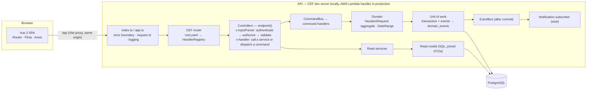
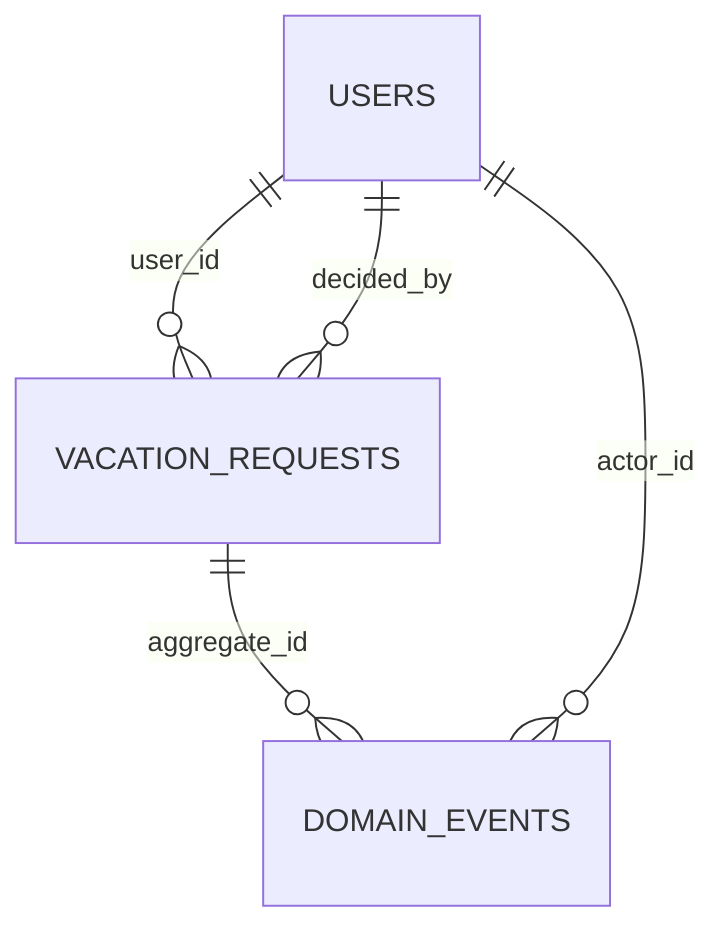

# LeaveFlow — vacation request management

Employees (**requesters**) submit vacation requests; managers (**validators**) review, approve or reject them; everyone sees a shared **team planning** calendar.

Built for the TravelFactory home assignment with **Vue 3**, **Node.js on [`commoneventframework`](https://www.npmjs.com/package/commoneventframework)**, **PostgreSQL + TypeORM** and **Tailwind CSS**, as a modular monolith with an explicit **command / query / event** architecture.

- [Quick start](#quick-start)
- [What you can do](#what-you-can-do)
- [Architecture](#architecture)
- [Business rules and how they are enforced](#business-rules-and-how-they-are-enforced)
- [Database](#database)
- [API](#api)
- [Testing](#testing)
- [Technical decisions](#technical-decisions)
- [Known limitations](#known-limitations)
- [How this was built](#how-this-was-built)

---

## Quick start

**Prerequisites:** Node.js **≥ 20.19** (`.nvmrc` pins 24 LTS) and Docker (for PostgreSQL).

```bash
npm install          # installs all workspaces
npm run setup        # creates apps/api/.env, starts PostgreSQL, runs migrations, seeds demo data
npm run dev          # API on http://localhost:3000 + web on http://localhost:5173
```

Open **http://localhost:5173** and sign in with a demo account (also one click away on the login page):

| User            | Role      | Email                 | Password         |
| --------------- | --------- | --------------------- | ---------------- |
| Alice Cohen     | Requester | `alice@leaveflow.dev` | `LeaveFlow!2026` |
| Bob Levi        | Requester | `bob@leaveflow.dev`   | `LeaveFlow!2026` |
| Dana Mizrahi    | Validator | `dana@leaveflow.dev`  | `LeaveFlow!2026` |
| Yossi Ben-David | Validator | `yossi@leaveflow.dev` | `LeaveFlow!2026` |

> Sessions are **per browser tab**, so you can keep a requester and a validator open side by side.
> Interactive API docs (Swagger UI generated by CEF from `root.yaml`): **http://localhost:3000/doc**.

### Database setup

`npm run setup` covers it. Under the hood:

| Command                                       | What it does                                                                                                            |
| --------------------------------------------- | ----------------------------------------------------------------------------------------------------------------------- |
| `npm run db:up`                               | Starts `postgres:16-alpine` on **host port 5544** (5432 is often taken) with databases `leaveflow` and `leaveflow_test` |
| `npm run db:migrate`                          | Applies TypeORM migrations (`synchronize` is off — the schema is only ever changed by migrations)                       |
| `npm run db:seed`                             | Idempotent seed: 4 users and 5 requests, created **through the command bus** so seed data passes every business rule    |
| `npm run db:reset`                            | Drops the volume and rebuilds everything                                                                                |
| `npm run db:migrate:revert -w @leaveflow/api` | Reverts the latest migration                                                                                            |

Not using Docker? Point `DATABASE_URL` / `TEST_DATABASE_URL` in `apps/api/.env` at any PostgreSQL ≥ 13 (the `btree_gist` extension, bundled with PostgreSQL, is created by the migration).

### All scripts

| Command                             | Purpose                                                                          |
| ----------------------------------- | -------------------------------------------------------------------------------- |
| `npm run dev`                       | API (CEF dev server, watch mode) and web (Vite) together                         |
| `npm test`                          | All test suites (contracts, API unit + integration, web) — needs the database up |
| `npm run verify`                    | Format check, lint, typecheck, CEF codegen drift check, tests                    |
| `npm run build`                     | Lambda bundle via `cef-build` (`apps/api/dist`) and the web production build     |
| `npm run codegen -w @leaveflow/api` | Regenerates the CEF handler registry after editing `root.yaml`                   |

---

## What you can do

**Requester** — submit a request (start, end, optional reason) · see own requests with status, decider, comment and history · team planning.
**Validator** — dashboard of all requests, filter by status and employee (kept in the URL), pagination · approve (optional comment) · reject (comment required) · team planning.

**Team planning** shows approved **and** pending vacations of everyone for a month, as a timeline — without reasons or comments.

---

## Architecture



### Layers and modules

```
apps/api/src/
  index.ts, app.ts          CEF entry: loadEnv, generated registry, never-throwing handler
  root.yaml                 OpenAPI 3.0 + x-handler / x-inputParser — the routing source of truth
  generated/                HandlerRegistry.ts (generated, committed, drift-checked)
  bootstrap/                env config (validated, fail fast) · composition root (manual DI)
  shared/
    domain/                 ApplicationError hierarchy · AggregateRoot · DomainEvent
    application/            CommandBus (+ middleware) · EventBus · UnitOfWork · Clock ports
    http/                   endpoint() · Problem Details mapping · request parsing · request context
    infrastructure/         DataSource · unit of work · PG error translation · pino logger · clocks
  modules/
    auth/                   AuthService (login, me), JWT, bcrypt
    users/                  UsersService
    vacation-requests/
      domain/               VacationRequest aggregate, DateRange, events, errors   ← no framework imports
      application/          commands/ (write side), vacation-request-queries.ts (read service), ports/
      infrastructure/       TypeORM entity, repository (writes), read model (reads)
      controllers/          endpoints referenced from root.yaml
    notifications/          event subscribers
  migrations/
packages/contracts/         enums, DTO types, zod schemas, error codes — shared by API and web
apps/web/src/               api/ · stores/ · router/ · composables/ · components/ · views/
```

Dependencies point inward: `domain` ← `application` ← `infrastructure` / `controllers`.

### The same layers in familiar terms

| Familiar term    | Here                                                                                    | Example                                    |
| ---------------- | --------------------------------------------------------------------------------------- | ------------------------------------------ |
| Module           | `modules/<feature>/` + `<feature>.module.ts` (wires the feature, like NestJS providers) | `vacation-requests.module.ts`              |
| Controller       | `controllers/*.controller.ts` — the functions `root.yaml` routes to                     | `vacation-requests.controller.ts`          |
| Service (reads)  | `*Service` / `*Queries` classes                                                         | `VacationRequestQueries`, `AuthService`    |
| Service (writes) | one command handler per use case, dispatched on the `CommandBus`                        | `CreateVacationRequestHandler`             |
| Repository       | `infrastructure/*-repository.ts` (writes) and `*-read-model.ts` (reads)                 | `TypeOrmVacationRequestRepository`         |
| Entity / model   | TypeORM entity (persistence) + domain aggregate (rules)                                 | `VacationRequestEntity`, `VacationRequest` |

**Why commands for writes but plain services for reads:** the brief asks for commands and events for state changes (`CreateVacationRequestCommand`, "vacation approved" events), and that is where a bus, a unit of work and events pay off — one transaction, one audited event per change. Reads change nothing, so they are ordinary service methods.

### Commands, read services, events

| Kind         | Name                                                                                                                 | Notes                                                                    |
| ------------ | -------------------------------------------------------------------------------------------------------------------- | ------------------------------------------------------------------------ |
| Command      | `CreateVacationRequestCommand`                                                                                       | returns `{ id, created }`; the DTO is read back through the read service |
| Command      | `ApproveVacationRequestCommand`                                                                                      | compare-and-set; repeat = no-op                                          |
| Command      | `RejectVacationRequestCommand`                                                                                       | comment required                                                         |
| Read service | `VacationRequestQueries` (`getById`, `listMine`, `listAll`, `teamCalendar`, `events`), `AuthService`, `UsersService` | no bus — reads change nothing                                            |
| Event        | `VacationRequestCreated`, `VacationRequestApproved`, `VacationRequestRejected`                                       | ids and dates only — never free text                                     |

**Event delivery (outbox-lite):** events are inserted into `domain_events` **in the same transaction** as the state change, then published to in-process subscribers **only after commit**. A rolled-back change leaves no event; a committed change always has one; a failing subscriber is logged and never fails the request. `domain_events` doubles as the audit trail shown in the UI ("History").

### How `commoneventframework` is used — and what I found in it

CEF (TravelFactory's package, v1.0.19, source reviewed) is **not an event bus**: it is an AWS-Lambda HTTP adapter that normalises API Gateway / SQS / S3 / direct-invoke events into a `CommonEvent`, routes them via an OpenAPI file, and ships a local dev server and Swagger UI. So the command/event buses are this project's own, and CEF is the HTTP edge:

- every route is declared in [`apps/api/src/root.yaml`](apps/api/src/root.yaml) with `x-handler` / `x-inputParser`, and the generated `HandlerRegistry.ts` is committed and drift-checked (`npm run codegen:check -w @leaveflow/api`);
- the API runs on CEF's dev server locally and exports a Lambda `handler` for production (`npm run build` → `cef-build`);
- the event bus is a port; in production it could publish to **SQS**, which CEF already routes to handlers in the same Lambda.

Sharp edges discovered while reading/running CEF, and how the code handles them:

| Finding                                                                                                                  | Consequence                                               | Handling                                                             |
| ------------------------------------------------------------------------------------------------------------------------ | --------------------------------------------------------- | -------------------------------------------------------------------- |
| Dev server's `catch` calls `res.end()` with an object                                                                    | a thrown handler error crashes the process                | `app.ts` never throws: every outcome is a `Response` (verified live) |
| Preflight answers `Allow-Methods` without `PATCH` and `Allow-Headers: *` (which never covers `Authorization`)            | cross-origin bearer calls and `PATCH` fail in the browser | Vite same-origin proxy; task-based `POST …/approve` / `…/reject`     |
| `Response` reads `FRONT_END_URL` at import time, before `loadEnv()`                                                      | the variable from `.env` is ignored                       | not relied upon (same-origin)                                        |
| README's sample entry calls the input parser synchronously and returns `new Response(500, err)`                          | async parsers break; errors leak or become `{}`           | own entry awaits the parser and maps errors to Problem Details       |
| Query-string values are not URL-decoded                                                                                  | `%20`, `+` reach the app raw                              | decoded in `EndpointRequest.query()`                                 |
| `root.yaml` is located from `argv[1]`                                                                                    | not found under test runners                              | path passed explicitly on the first `buildCommonEvent` call          |
| `cef-gen-handlers` bin exits 0 **without writing** when run via npm/npx (direct-execution guard compares a symlink path) | silently stale registry                                   | `scripts/codegen.js` calls the generator directly (+ `--check`)      |
| `/context` and `/dependencies` built-ins expose runtime metadata                                                         | information disclosure                                    | served only when `NODE_ENV=development`                              |
| Dev server binds `localhost` only                                                                                        | unreachable from outside a container                      | API runs natively; only PostgreSQL is containerised                  |
| Build uses esbuild (no decorator metadata)                                                                               | TypeORM types and reflection-based DI break               | explicit column types everywhere; manual composition root            |

---

## Business rules and how they are enforced

| #   | Rule (brief)                         | Interpretation                                                                                            | Domain                                 | Database                                                                          | UI                           |
| --- | ------------------------------------ | --------------------------------------------------------------------------------------------------------- | -------------------------------------- | --------------------------------------------------------------------------------- | ---------------------------- |
| 1   | End date after start date            | **Strictly after**, as written — a single-day vacation is therefore impossible (deliberate, see below)    | `DateRange`                            | `CHECK (end_date > start_date)`                                                   | inline hint                  |
| 2   | No overlapping requests for one user | Inclusive ranges; only **pending and approved** requests block; rejected ones don't                       | pre-check naming the conflicting range | **`EXCLUDE USING gist`** on `(user_id, daterange)` where active                   | message with the range       |
| 3   | Approved requests can't be modified  | `APPROVED` and `REJECTED` are terminal; only `PENDING → APPROVED/REJECTED`                                | aggregate                              | compare-and-set `UPDATE … WHERE status = 'PENDING'`; decision-consistency `CHECK` | actions only on pending rows |
| 4   | No requests in the past              | Start ≥ today in the business time zone (`BUSINESS_TIMEZONE`, default `Asia/Jerusalem`); today is allowed | aggregate + injected clock             | — (a `CURRENT_DATE` check would invalidate history)                               | `min` on the date input      |
| 5   | Rejection needs a comment            | non-blank after trimming                                                                                  | aggregate                              | `CHECK`                                                                           | Reject disabled until filled |
| 6   | Only validators decide               | and only requesters submit (so self-approval cannot happen)                                               | command handlers                       | —                                                                                 | routes and actions per role  |

Rules are enforced on the server; the UI mirrors them for instant feedback only.

**Why "strictly after":** the brief says the end date must be _after_ the start date. I implemented it literally and documented the consequence rather than silently reinterpreting a stated rule. Relaxing it is a two-line change (`DateRange.of` and the `vr_end_after_start` constraint).

### Concurrency and idempotency

- **Two submissions racing** (double click, two tabs): submissions of one user are serialised with a transaction-scoped advisory lock, the exclusion constraint is the final guarantee, and the loser receives `409 VACATION_OVERLAP`. Concurrent conflicting inserts on an exclusion constraint otherwise _deadlock_ in PostgreSQL — the integration suite caught exactly that (as `500`s) before the lock was added.
- **Two validators racing** (approve vs reject): compare-and-set update; exactly one wins and emits one event; the other gets `409 REQUEST_NOT_PENDING` naming who decided ("already rejected by Yossi Ben-David").
- **Retries:** `POST /vacation-requests` accepts an `Idempotency-Key` (the web app sends one per form session). Same key + same payload → the original request (`200`); same key + different payload → `409 IDEMPOTENCY_KEY_REUSED`. Repeating an existing decision returns `200` without a new event.

---

## Database



Schema: [`InitialSchema` migration](apps/api/src/migrations/1760432400000-InitialSchema.ts). The brief's columns are all present; additions are `decided_by`, `decided_at` (who decided and when), `idempotency_key`, and the `domain_events` table. The brief's `password` column is `password_hash` (bcrypt) and is never selected unless explicitly requested.

| Index                                                      | Serves                                    |
| ---------------------------------------------------------- | ----------------------------------------- |
| `users_email_key` (unique)                                 | login                                     |
| `vr_user_created_idx (user_id, created_at DESC, id DESC)`  | "my requests", user filter, FK lookups    |
| `vr_status_created_idx (status, created_at DESC, id DESC)` | dashboard filtered by status              |
| `vr_created_idx (created_at DESC, id DESC)`                | dashboard unfiltered                      |
| GiST behind `vr_no_overlapping_active`                     | overlap checks, team-calendar range scans |
| `vr_user_idempotency_key` (unique, partial)                | idempotent replay                         |
| `domain_events_aggregate_idx (aggregate_id, seq)`          | request history                           |

Pagination is offset-based with a deterministic order (`created_at DESC, id DESC` — the `id` tiebreaker keeps rows from repeating or vanishing between pages) and `pageSize` capped at 100. Calendar dates are `DATE` columns returned as `YYYY-MM-DD` strings end to end, so no time zone ever shifts a day.

---

## API

Base URL `http://localhost:3000` (the web app calls it as `/api`). Full schema: **`/doc`**.

| Method | Path                             | Role              | Purpose                                                  |
| ------ | -------------------------------- | ----------------- | -------------------------------------------------------- |
| POST   | `/auth/login`                    | public            | email + password → JWT + profile                         |
| GET    | `/auth/me`                       | any               | current profile                                          |
| POST   | `/vacation-requests`             | requester         | submit (`201`, or `200` on idempotent replay)            |
| GET    | `/me/vacation-requests`          | requester         | own requests — `page`, `pageSize`, `status`              |
| GET    | `/vacation-requests`             | validator         | all requests — `page`, `pageSize`, `status`, `userId`    |
| POST   | `/vacation-requests/:id/approve` | validator         | approve, optional `comment`                              |
| POST   | `/vacation-requests/:id/reject`  | validator         | reject, required `comment`                               |
| GET    | `/vacation-requests/:id/events`  | owner / validator | audit trail                                              |
| GET    | `/team-calendar?from&to`         | any               | active requests in a ≤ 92-day window, no reason/comments |
| GET    | `/users?role=`                   | validator         | employee filter                                          |
| GET    | `/health`                        | public            | liveness + database                                      |

Lists return `{ items, pageInfo: { page, pageSize, totalItems, totalPages } }`.

**Errors** are [RFC 9457 Problem Details](https://www.rfc-editor.org/rfc/rfc9457) (`application/problem+json`) with a stable `code` and the `requestId` (also in the `x-request-id` header):

```json
{
  "type": "urn:leaveflow:problem:vacation-overlap",
  "title": "These dates overlap another active request of yours.",
  "status": 409,
  "code": "VACATION_OVERLAP",
  "conflictingRange": { "id": "…", "startDate": "2026-11-09", "endDate": "2026-11-13" },
  "requestId": "4f1c…"
}
```

`400` malformed JSON · `401` unauthenticated / invalid credentials · `403` wrong role · `404` not found (also for another user's request, so existence isn't revealed) · `409` overlap, not pending, idempotency-key reuse · `422` validation and business rules · `500` generic, details only in logs.

**Auth:** HS256 JWT (algorithm pinned; `iss`, `aud`, `exp` verified), 8 h lifetime. Login answers wrong-password and unknown-email identically, and compares against a dummy hash so timing doesn't reveal accounts. Authentication and authorisation run in CEF's input-parser stage, **before** validation, so an anonymous caller gets `401`, never a `422` that probes the schema.

**Logs:** one JSON line per request (`requestId`, user, method, path, status, duration, error code) and per command/query (name, outcome, duration). Tokens, passwords, reasons and comments are never logged (redaction is tested).

---

## Testing

```bash
npm run db:up && npm test      # 196 tests
```

| Suite                | Count | What it proves                                                                                                                                                                                                                                                                                                                                                                                                                                                                                                                                                                                      |
| -------------------- | ----- | --------------------------------------------------------------------------------------------------------------------------------------------------------------------------------------------------------------------------------------------------------------------------------------------------------------------------------------------------------------------------------------------------------------------------------------------------------------------------------------------------------------------------------------------------------------------------------------------------- |
| `packages/contracts` | 27    | calendar-date validation (rejects `2026-02-30`), schemas, pagination caps, date arithmetic                                                                                                                                                                                                                                                                                                                                                                                                                                                                                                          |
| API unit             | 56    | `DateRange`, aggregate rules and events, command handlers incl. lost-race paths (in-memory fakes), buses, JWT edge cases (expired, foreign secret, `alg: none`), error mapping                                                                                                                                                                                                                                                                                                                                                                                                                      |
| API integration      | 93    | the **real CEF handler** against **real PostgreSQL**, asserting stored rows and events, not just responses — RBAC matrix for every endpoint, IDOR, every business rule, overlap matrix, idempotency, **10-way submission races and approve-vs-reject races (repeated)**, stable pagination on tied timestamps, team-calendar projection, query plans use the intended indexes, every DB constraint by direct SQL, migration down/up, Problem Details contract, `500` hides internals and the process keeps serving, events only after commit, log redaction, dates under foreign process time zones |
| Web                  | 20    | decision dialog (comment rules, a11y, Esc), pagination, status badge, error mapper, date display under several time zones                                                                                                                                                                                                                                                                                                                                                                                                                                                                           |

The UI was also walked end to end in a browser as both roles (including a two-validator race and a 390 px viewport).

---

## Technical decisions

The full reasoning, with rejected alternatives, is in the spec: [`docs/specs/SPEC-001-leave-management/epic.md` §11.3](docs/specs/SPEC-001-leave-management/epic.md). Highlights:

- **Modular monolith: commands for writes, services for reads** — state changes go through commands, a unit of work and events; reads are plain services over a SQL read model. No event sourcing, no broker, no query bus (KISS — see [SPEC-002](docs/specs/SPEC-002-simplify-architecture/spec.md)).
- **Own command bus and event bus instead of a framework** — a few dozen typed lines each; NestJS would have replaced CEF's routing, which is the part being evaluated.
- **Invariants in the database too** — exclusion constraint, `CHECK`s and compare-and-set make the rules hold under concurrency, not just in the happy path.
- **Task-based endpoints** (`POST …/approve`) map 1:1 to commands and avoid CEF's missing `PATCH`.
- **Shared contracts package** — one set of enums, DTOs, zod schemas and error codes for API and web.
- **Per-tab sessions** (`sessionStorage`) — convenient for reviewing two roles at once; production would use an httpOnly cookie.

---

## Known limitations

- **Single team.** There is no team/department model; everyone sees everyone in team planning.
- **No cancel/edit of a request**, no leave balances, half days or public holidays.
- **Notifications are a logging stub**; the outbox is "lite" — an event persisted but not yet published when the process dies is not re-delivered (a relay or SQS publisher is the next step).
- **Auth is demo-grade:** no refresh tokens, password reset, user management or login rate limiting; the token lives in `sessionStorage` (XSS-readable) rather than an httpOnly cookie.
- **No request-body size limit** on CEF's dev server.
- **Offset pagination** — fine at this scale; keyset pagination is the path for very large tables.
- **CEF dependencies:** `npm audit` still reports moderate advisories in `aws-sdk` v2, pulled in by CEF's `aws-lambda` dependency. It is not loaded at runtime (CEF only imports types from it); the high-severity `adm-zip` / `esbuild` advisories in CEF's build tooling are overridden to patched versions in the root `package.json`.
- **CEF prints its own `console.log` line per request** (`isCommonEvent`), next to the structured logs.
- **No CI pipeline and no automated browser E2E** (the UI was verified manually); English only.
- `/doc` loads the Swagger UI script from a CDN.

Deferred items are tracked in [`docs/future-work.md`](docs/future-work.md).

---

## How this was built

AI assistance was allowed for this assignment; I used Claude Code as a pair programmer, driven by a **spec-driven development** workflow (vendored skill in `.claude/skills/spec-development`, process in [`docs/workflow.md`](docs/workflow.md)):

1. analysis of the brief and of CEF's source → decisions recorded with the owner;
2. [`epic.md`](docs/specs/SPEC-001-leave-management/epic.md) (requirements, data model, API, acceptance criteria) → [`tasks.md`](docs/specs/SPEC-001-leave-management/tasks.md) → [`plan.md`](docs/specs/SPEC-001-leave-management/plan.md);
3. implementation task by task, one conventional commit each, against a [verification checklist](docs/specs/SPEC-001-leave-management/verification-checklist.md).

Defects found by the tests during implementation (an exclusion-constraint deadlock and event-order ties) were fixed and recorded in the epic's change log.

### Troubleshooting

- **Port 5544, 3000 or 5173 in use** — stop the other process, or change the port (`POSTGRES_PORT=… npm run db:up` and the URLs in `apps/api/.env`).
- **`npm test` fails to connect** — run `npm run db:up` first.
- **Changed `root.yaml`** — run `npm run codegen -w @leaveflow/api`.
