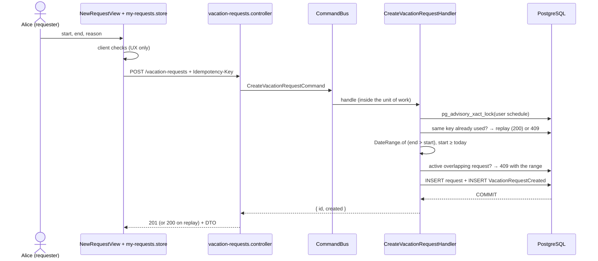

# F-02 — Submit a vacation request

## Purpose

Let a requester ask for leave over a date range, enforcing every business rule even under concurrency.

## Actors

Requester (validators cannot submit — decision D-3).

## Flow

## Rules

| #    | Rule                                                                                                 | Where enforced                                  |
| ---- | ---------------------------------------------------------------------------------------------------- | ----------------------------------------------- |
| BR-1 | End date (= first day back at work) strictly after the start date — 2 Nov → 3 Nov is one day off     | `DateRange.of`, `CHECK (end_date > start_date)` |
| BR-2 | No shared day off with the user's own PENDING/APPROVED requests; ranges are half-open `[start, end)` | handler pre-check, `EXCLUDE USING gist`         |
| BR-4 | Start date ≥ today in `BUSINESS_TIMEZONE`                                                            | aggregate + injected `Clock`                    |
| BR-6 | Only requesters submit                                                                               | controller role + handler check                 |
| —    | Reason optional, trimmed, ≤ 500 chars                                                                | zod schema                                      |

## API

`POST /vacation-requests` — body `{ startDate, endDate, reason? }`, header `Idempotency-Key` (UUID, optional). 201 created / 200 replay; 409 `VACATION_OVERLAP` (with `conflictingRange`) or `IDEMPOTENCY_KEY_REUSED`; 422 `INVALID_DATE_RANGE`, `START_DATE_IN_PAST`, `VALIDATION_FAILED`; 403 for validators.

## Data

Inserts into `vacation_requests` (status `PENDING`) and `domain_events` (`VacationRequestCreated`) in one transaction.

## Security

Requester identity from the token only; input validated before the handler; no free text in the event payload.

## Edge cases

| Case                                            | Behaviour                                                                                             |
| ----------------------------------------------- | ----------------------------------------------------------------------------------------------------- |
| Double click / lost response                    | same Idempotency-Key → original request (200); the web store keeps the key only after a network error |
| Same key, different dates                       | 409 `IDEMPOTENCY_KEY_REUSED`                                                                          |
| 10 overlapping submissions at once              | per-user lock serialises them: one 201, nine 409                                                      |
| Overlap with a rejected request                 | allowed                                                                                               |
| `2026-02-30`                                    | 422 field error on `startDate`                                                                        |
| Start = today                                   | allowed                                                                                               |
| 2 Nov → 3 Nov                                   | one day off (201)                                                                                     |
| Next vacation starts on the previous return day | allowed — no shared day off                                                                           |

## Acceptance criteria → tests

| Criterion                                                      | Test                                                                                                                                         |
| -------------------------------------------------------------- | -------------------------------------------------------------------------------------------------------------------------------------------- |
| Row + one Created event persisted                              | `apps/api/test/integration/vacation-create.test.ts`                                                                                          |
| BR-1, BR-4, overlap matrix, idempotency, 10-way race, TZ flips | `apps/api/test/integration/vacation-create.test.ts`                                                                                          |
| Rules in the domain                                            | `apps/api/src/modules/vacation-requests/domain/date-range.test.ts`, `apps/api/src/modules/vacation-requests/domain/vacation-request.test.ts` |
| Handler branches (replay, reuse, overlap message)              | `apps/api/src/modules/vacation-requests/commands/commands.test.ts`                                                                           |
| DB constraints by direct SQL                                   | `apps/api/test/integration/schema-constraints.test.ts`                                                                                       |
| Store key handling                                             | `apps/web/src/features/my-requests/my-requests.store.test.ts`                                                                                |

## Code map

- API: `apps/api/src/modules/vacation-requests/commands/create-vacation-request.command.ts`, `.../commands/create-vacation-request.handler.ts`, `.../domain/vacation-request.ts`, `.../domain/date-range.ts`, `.../repositories/typeorm-vacation-request.repository.ts`
- Web: `apps/web/src/features/my-requests/views/NewRequestView.vue`, `.../my-requests.store.ts`, `.../components/DateRangeFields.vue`
