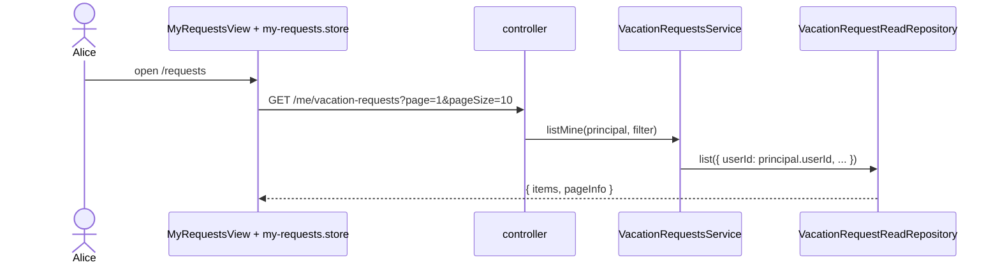

# F-03 — My requests

## Purpose

Show a requester their own requests with status, decision, decider, comment and history.

## Actors

Requester.

## Flow

## Rules

- Scope comes **only** from the token (`userId` query parameters are ignored).
- Newest first: `created_at DESC, id DESC` (the `id` tie-breaker keeps pagination stable).
- `pageSize` 1–100 (default 20; the UI uses 10).
- Rejected requests show the validator's comment; history comes from `domain_events`.

## API

`GET /me/vacation-requests?page&pageSize&status` → `{ items: VacationRequestDto[], pageInfo }`. `GET /vacation-requests/:id/events` → audit trail (owner or validator; another requester gets 404).

## Data

Read model joins `users` twice (owner, decider) in one query — no N+1. Index `vr_user_created_idx`.

## Security

Requester-only route; IDOR-safe (scope from token; foreign ids → 404).

## Edge cases

Empty list → empty state with CTA; load failure → error state with retry; stale responses are dropped by the store.

## Acceptance criteria → tests

| Criterion                                        | Test                                                               |
| ------------------------------------------------ | ------------------------------------------------------------------ |
| Only own rows, newest first, page info           | `apps/api/test/integration/vacation-queries.test.ts`               |
| `userId` parameter ignored; foreign events → 404 | `apps/api/test/integration/rbac.test.ts`                           |
| Index used                                       | `apps/api/test/integration/vacation-queries.test.ts` (query plans) |
| Store paging                                     | `apps/web/src/features/my-requests/my-requests.store.test.ts`      |

## Code map

- API: `apps/api/src/modules/vacation-requests/services/vacation-requests.service.ts`, `.../repositories/typeorm-vacation-request-read.repository.ts`
- Web: `apps/web/src/features/my-requests/views/MyRequestsView.vue`, `apps/web/src/features/vacation-requests/components/DecisionInfo.vue`, `apps/web/src/features/vacation-requests/components/RequestHistory.vue`
