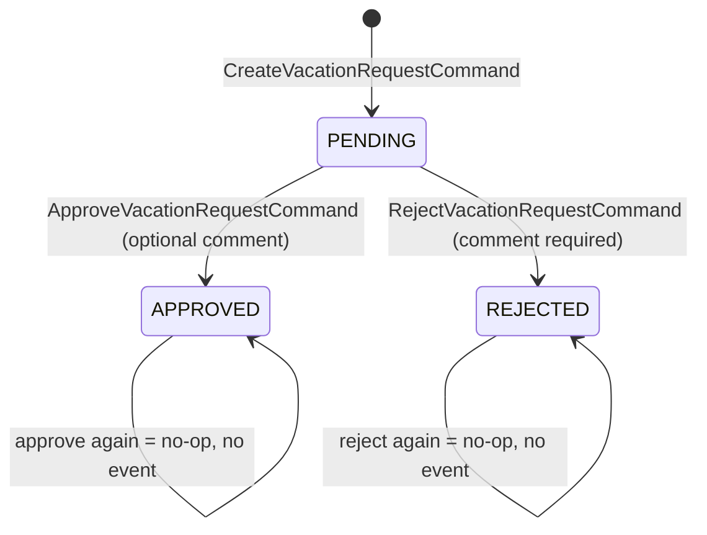
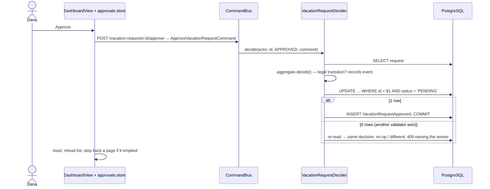

# F-04 — Approval workflow (dashboard, approve, reject)

## Purpose

Let validators review all requests, filter and page through them, and approve or reject pending ones exactly once.

## Actors

Validator (Dana, Yossi in the demo data).

## Flow

## Rules

| #    | Rule                                                                    | Where enforced                                                        |
| ---- | ----------------------------------------------------------------------- | --------------------------------------------------------------------- |
| BR-3 | APPROVED and REJECTED are terminal                                      | aggregate; compare-and-set; `vr_decision_consistency` CHECK           |
| BR-5 | Rejection needs a non-blank comment                                     | aggregate; `vr_rejection_needs_comment` CHECK; dialog disables Reject |
| BR-6 | Only validators decide                                                  | controller role + handler check                                       |
| —    | Filters: status (default PENDING) and employee, combinable; page in URL | view (URL) + store                                                    |

## API

| Method | Path                                                 | Success               | Errors                                          |
| ------ | ---------------------------------------------------- | --------------------- | ----------------------------------------------- |
| GET    | `/vacation-requests?page&pageSize&status&userId`     | `{ items, pageInfo }` | 422, 403                                        |
| POST   | `/vacation-requests/:id/approve` body `{ comment? }` | 200 DTO               | 404, 409 `REQUEST_NOT_PENDING`, 403             |
| POST   | `/vacation-requests/:id/reject` body `{ comment }`   | 200 DTO               | 422 `REJECTION_COMMENT_REQUIRED`, 404, 409, 403 |
| GET    | `/users?role=REQUESTER`                              | `{ items }`           | 403                                             |

## Data

Sets `status`, `comments`, `decided_by`, `decided_at`, `updated_at`; inserts `VacationRequestApproved|Rejected`. Indexes `vr_status_created_idx`, `vr_created_idx`.

## Security

Validator-only; approve/reject are task-based `POST`s (also avoids CEF's missing `PATCH`); every forbidden attempt leaves the row unchanged.

## Edge cases

| Case                               | Behaviour                                                                    |
| ---------------------------------- | ---------------------------------------------------------------------------- |
| Approve vs reject at the same time | exactly one wins, one event; loser 409 "already rejected by Yossi Ben-David" |
| Retry of the same decision         | 200, no second event                                                         |
| Rejected request approved later    | 409                                                                          |
| Last row of a page decided         | dashboard steps back a page                                                  |
| Whitespace-only comment            | Reject disabled; API 422                                                     |

## Acceptance criteria → tests

| Criterion                                                      | Test                                                                |
| -------------------------------------------------------------- | ------------------------------------------------------------------- |
| Approve/reject persist decider, time, comment and one event    | `apps/api/test/integration/vacation-decide.test.ts`                 |
| Terminal statuses, idempotent repeat, races (repeated)         | `apps/api/test/integration/vacation-decide.test.ts`                 |
| Lost-race branches                                             | `apps/api/src/modules/vacation-requests/commands/commands.test.ts`  |
| Filters, stable pagination on tied timestamps, invalid filters | `apps/api/test/integration/vacation-queries.test.ts`                |
| Dialog comment rules, a11y, Esc                                | `apps/web/src/features/approvals/components/DecisionDialog.test.ts` |
| Store: load, stale responses, decide outcomes, reload          | `apps/web/src/features/approvals/approvals.store.test.ts`           |

## Code map

- API: `apps/api/src/modules/vacation-requests/commands/approve-vacation-request.handler.ts`, `.../commands/reject-vacation-request.handler.ts`, `.../commands/vacation-request-decider.ts`, `.../repositories/typeorm-vacation-request.repository.ts` (`saveDecision`)
- Web: `apps/web/src/features/approvals/` — `views/DashboardView.vue`, `approvals.store.ts`, `approvals.api.ts`, `components/DecisionDialog.vue`
