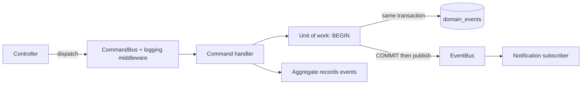

# F-06 — Commands, events and audit trail

## Purpose

Make every state change an explicit, named command that runs in one transaction and records a domain event — the architecture the brief asks for ("commands such as CreateVacationRequestCommand … events such as vacation approved").

## Flow

## Rules

- **Writes = commands** (`CreateVacationRequestCommand`, `ApproveVacationRequestCommand`, `RejectVacationRequestCommand`), each with exactly one handler. **Reads = services** (no bus — reads change nothing).
- Events: `VacationRequestCreated`, `VacationRequestApproved`, `VacationRequestRejected` — ids and dates only, never reason/comment text.
- Outbox-lite: events are written in the business transaction and published **after commit**; a failing subscriber is logged and never fails the request.
- `domain_events.seq` (identity) gives a stable order per aggregate; the table doubles as the audit trail shown as "History".

## API

`GET /vacation-requests/:id/events` → `[{ id, eventType, actor, occurredAt }]` (owner or validator).

## Edge cases

| Case                      | Behaviour                                              |
| ------------------------- | ------------------------------------------------------ |
| Command fails             | no event row, nothing published                        |
| Subscriber throws         | request still succeeds; error logged with the event id |
| Idempotent no-op decision | no event                                               |

## Acceptance criteria → tests

| Criterion                                                | Test                                                                                                     |
| -------------------------------------------------------- | -------------------------------------------------------------------------------------------------------- |
| Exactly one event per successful change, none on failure | `apps/api/test/integration/vacation-create.test.ts`, `apps/api/test/integration/vacation-decide.test.ts` |
| Publish after commit; failing subscriber isolated        | `apps/api/test/integration/http-contract.test.ts`, `apps/api/src/shared/cqrs/event-bus.test.ts`          |
| Bus routing and middleware order                         | `apps/api/src/shared/cqrs/command-bus.test.ts`                                                           |
| History endpoint                                         | `apps/api/test/integration/vacation-queries.test.ts`                                                     |

## Code map

`apps/api/src/shared/cqrs/command-bus.ts`, `apps/api/src/shared/cqrs/event-bus.ts`, `apps/api/src/shared/database/typeorm-unit-of-work.ts`, `apps/api/src/shared/domain/aggregate-root.ts`, `apps/api/src/modules/vacation-requests/domain/vacation-request.events.ts`, `apps/api/src/modules/notifications/subscribers/notification.subscriber.ts`, `apps/api/src/bootstrap/container.ts` (logging middleware)

**Production path:** the `EventBus` is a port — an SQS publisher can replace the in-process one, and CEF already routes SQS events (`/sqs/{queue}`) to handlers in the same Lambda.
