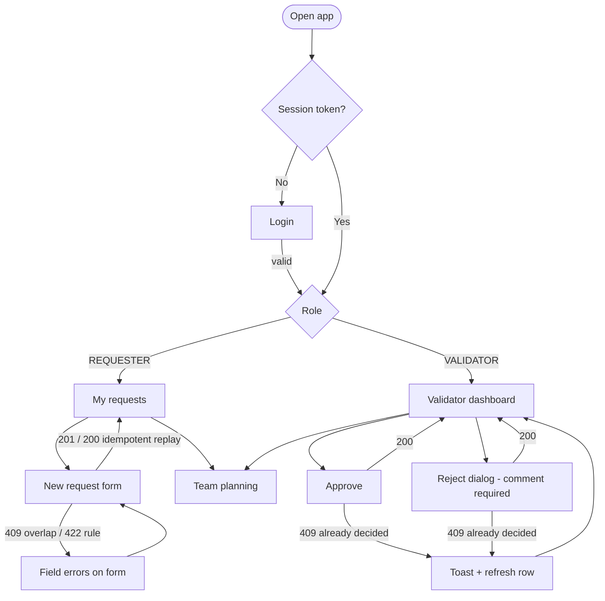
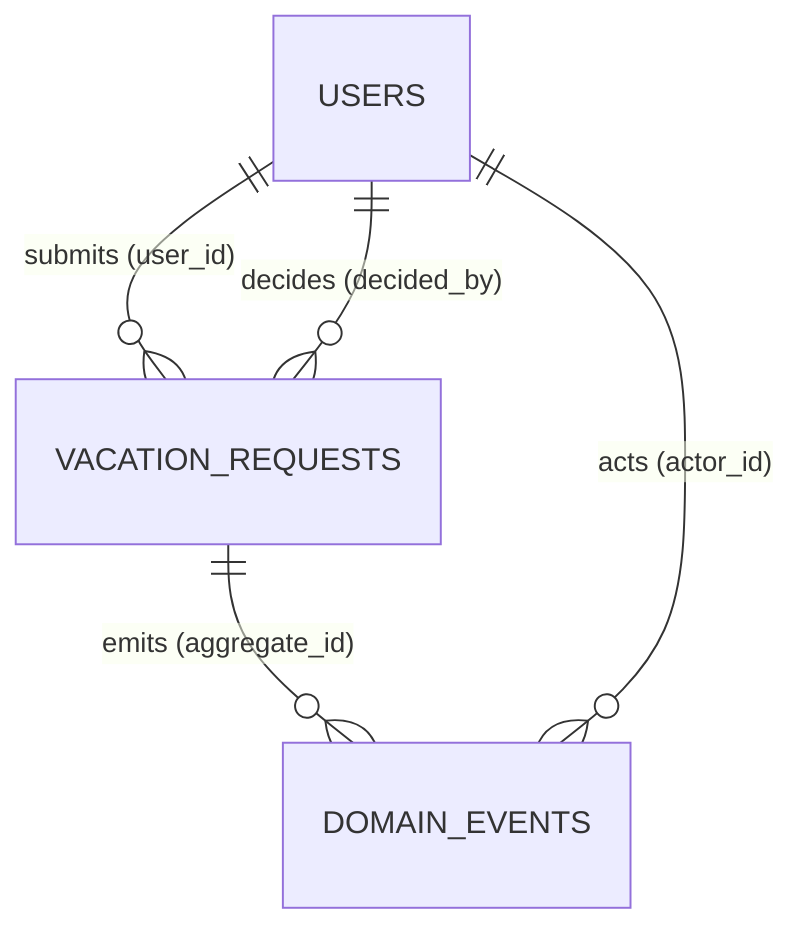
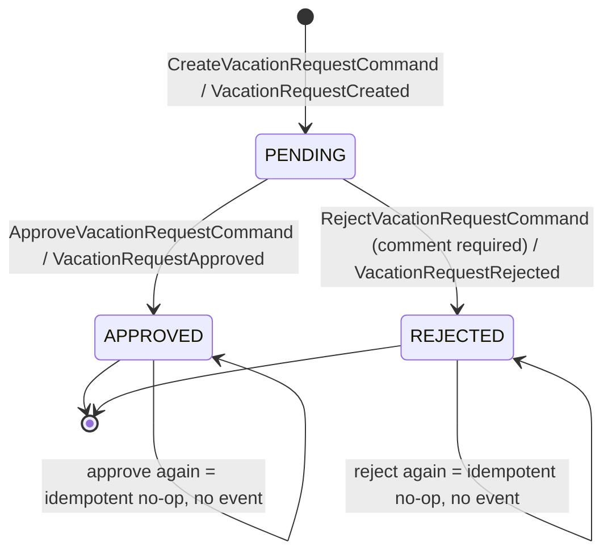
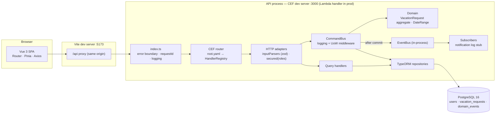
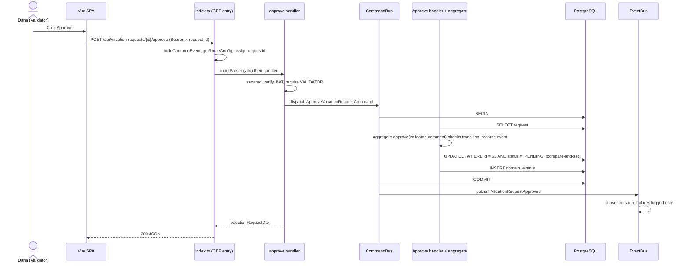
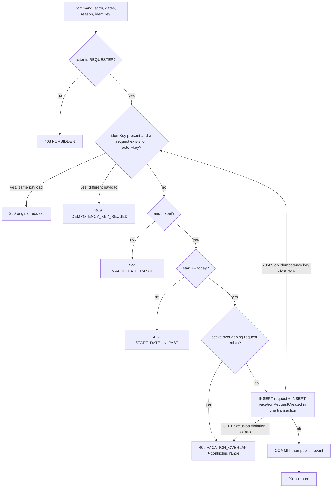
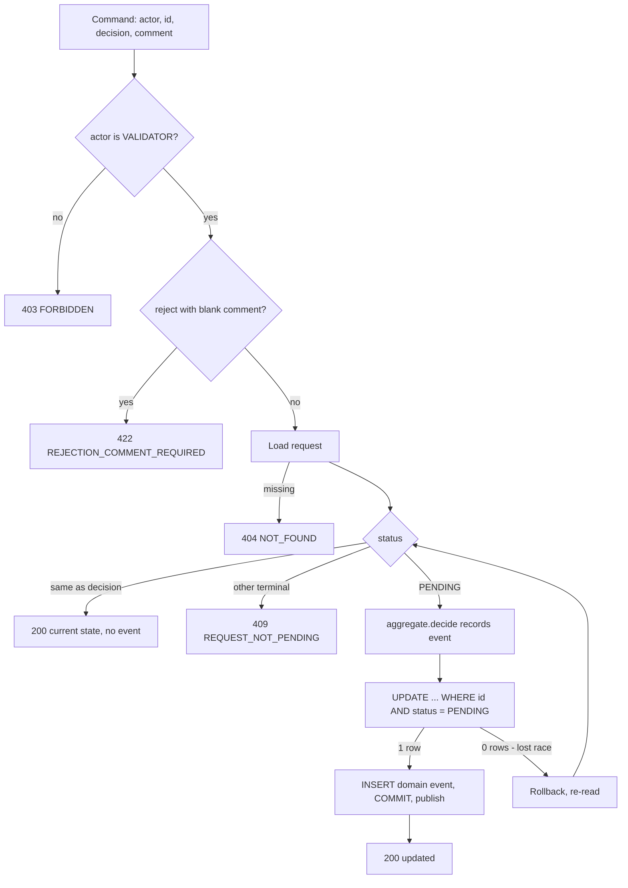

# SPEC-001: LeaveFlow — Vacation Request Management

---

## 1. Meta

| Field | Value |
|---|---|
| Spec ID | SPEC-001 |
| Title | LeaveFlow — Vacation Request Management |
| Status | `done` |
| Brownfield | no — greenfield repository |
| Version | 0.5 |
| Owner | Kobi Saada |
| Contributors | Claude (AI pair, permitted by the assignment) |
| Created | 2026-10-14 |
| Last updated | 2026-10-14 |
| Target release | TravelFactory home-assignment submission |
| Related specs | — |

---

## 2. Summary

LeaveFlow is a small web application in which employees (**Requesters**) submit vacation requests and managers (**Validators**) review, approve, or reject them. Both roles can see a shared team-planning view of who is away when. The product is deliberately small; the engineering is not. It is built as a modular monolith with an explicit command/event architecture on top of TravelFactory's `commoneventframework` (CEF), with business rules enforced in the domain **and** in PostgreSQL so that they still hold when requests race.

---

## 3. Business goal

- **Primary goal:** deliver a working, locally runnable vacation-management app that implements every requirement of the TravelFactory assignment, and that a reviewer can clone, start with documented commands, and exercise end-to-end as both roles within minutes.
- **Secondary goals:**
  - Make the architecture *visibly* command/event-oriented (named commands, named past-tense events, a bus for each), as the assignment explicitly evaluates this.
  - Show correct use of CEF — the reviewers' in-house framework — including awareness of its sharp edges.
  - Show production instincts sized to the brief: DB-level invariants, concurrency safety, consistent error contract, structured logs, migrations, tests against a real database, honest known-limitations.
- **Non-goals:**
  - Production deployment to AWS (the code is Lambda-shaped via CEF, but nothing is deployed).
  - HR-grade leave accounting (balances, accrual, public holidays, half days).
  - Visual design beyond clean, responsive, usable UI.

---

## 4. Context & background

- **Trigger:** TravelFactory hiring home assignment ("Web Development Intern Recruitment Test: Vacation Management Interface"). AI assistance is explicitly allowed. Expected effort stated as 2–3 hours with AI.
- **Prior art:** none — greenfield.
- **Decisions already made upstream (by the assignment — non-negotiable):**
  - Vue.js frontend with Vue Router and Axios; Tailwind CSS (or another modern CSS framework).
  - Node.js backend exposing RESTful endpoints.
  - PostgreSQL with TypeORM.
  - `commoneventframework` from npm.
  - JWT authentication is acceptable; pre-seeded demo users are acceptable.
  - Schema columns as listed in the brief (users: id, name, email, password, role, created_at; vacation_requests: id, user_id, start_date, end_date, reason, status, comments, created_at, updated_at).
  - Deliverables: public/private GitHub or Bitbucket repo, README (install, run, DB setup, technical decisions, known limitations), meaningful commits.
  - Process: email the recruiter on start and on completion (human task, not code).
- **Decisions made by the owner during analysis (2026-10-14):**
  - **D-1** Business rule 1 is implemented **literally**: `end_date` must be strictly after `start_date`. ~~Consequence: a single-day vacation is impossible.~~ **Superseded by SPEC-005 (v0.5):** the end date is the first day back at work, so ranges are half-open and a single day off is possible.
  - **D-2** Team planning shows **approved and pending** requests (pending visually distinguished), never reason or comments.
  - **D-3** Only Requesters submit requests; Validators only decide. Self-approval is therefore structurally impossible.
  - **D-4** Test scope: domain unit tests + API integration tests against a real PostgreSQL.
- **Key finding about CEF (from reading its source, v1.0.19):** CEF is **not** an event bus. It is an AWS-Lambda HTTP adapter: it normalises API Gateway v1/v2, SQS, S3, SNS and direct-invoke events into a single `CommonEvent`, routes by an OpenAPI file (`root.yaml`, extensions `x-handler` / `x-inputParser`), generates a static `HandlerRegistry`, ships a local dev server, and serves Swagger at `/doc`. The command bus and event bus required by the brief are therefore ours. CEF's sharp edges that shape this design are listed in §11.3 and §23.

---

## 5. Glossary

| Term | Definition | Source |
|---|---|---|
| Requester | Employee role. Submits vacation requests and sees their own. Brief: "מבקש". | Assignment |
| Validator | Manager role. Sees all requests, approves or rejects. Brief: "מאמת" (verifier/approver). | Assignment |
| Vacation request | A request for leave over an inclusive date range `[start_date, end_date]`. | Assignment |
| Active request | A request in status `PENDING` or `APPROVED`. Only active requests participate in the overlap rule. | This epic |
| Terminal status | `APPROVED` or `REJECTED`. No transition leaves a terminal status. | This epic |
| Business date / "today" | The calendar date in the configured business time zone (`BUSINESS_TIMEZONE`, default `Asia/Jerusalem`). | This epic |
| CEF | `commoneventframework` — TravelFactory's Lambda HTTP adapter (see §4). | npm |
| `CommonEvent` | CEF's normalised request object (path, method, body string, path/query params, headers). | CEF |
| Command | An intent to change state, named imperatively (`CreateVacationRequestCommand`). Exactly one handler. | This epic |
| Domain event | A fact that happened, named in past tense (`VacationRequestApproved`). Zero or more subscribers. | This epic |
| Outbox-lite | Domain events are written to `domain_events` in the same transaction as the state change, then dispatched in-process after commit. No separate relay process. | This epic |
| Problem Details | RFC 9457 (formerly RFC 7807) JSON error body, `application/problem+json`. | IETF |
| Idempotency key | Client-generated UUID sent as `Idempotency-Key` header so a retried create returns the original result instead of a conflict. | This epic |

---

## 6. Users & roles affected

- **Requester (e.g. Alice Cohen, backend developer):** logs in, submits requests, sees each request's status and — when rejected — the validator's comment. Checks the team-planning view before choosing dates so as not to collide with colleagues.
- **Validator (e.g. Dana Mizrahi, team lead):** logs in to a dashboard of all requests, narrows it by status and/or employee, pages through results, approves or rejects (rejection requires a comment). Uses the same team-planning view to see coverage before approving.
- **Regional / segment variations:** none. Single team, single business time zone, English UI.

---

## 7. User stories & scenarios

### 7.1 Primary user stories

- **US-1:** As a Requester, I want to log in with my email and password, so that I see only what my role allows.
- **US-2:** As a Requester, I want to submit a vacation request with a start date, an end date and an optional reason, so that my manager can decide on it.
- **US-3:** As a Requester, I want to see a paginated list of my requests with their status and any rejection comment, so that I know where each request stands and why.
- **US-4:** As a Requester or Validator, I want to see the team's approved and pending vacations over a date window, so that I can plan around colleagues' absences.
- **US-5:** As a Validator, I want a dashboard of all requests that I can filter by status and by employee and page through, so that I can work through the queue efficiently.
- **US-6:** As a Validator, I want to approve a pending request, so that the employee's vacation is confirmed.
- **US-7:** As a Validator, I want to reject a pending request with a mandatory comment, so that the employee understands the decision.
- **US-8:** As a reviewer of this assignment, I want to clone the repo and get it running with a few documented commands and seeded demo users, so that I can evaluate it quickly.

### 7.2 Happy-path scenario

1. Alice opens LeaveFlow and signs in as `alice@leaveflow.dev`. She lands on **My requests**, which is empty.
2. She opens **Team planning**, sees that Bob is away 2026-11-02 → 2026-11-06 (approved), and picks 2026-11-09 → 2026-11-13 instead.
3. On **New request** she enters start `2026-11-09`, end `2026-11-13`, reason "Family trip", and submits. The button is disabled while the request is in flight. She is returned to **My requests** with a success toast; the new row shows **Pending**.
4. In another browser tab (tokens are per-tab), Dana signs in as `dana@leaveflow.dev` and lands on the **Validator dashboard**, filtered to **Pending** by default. Alice's request is at the top (newest first).
5. Dana clicks **Approve**. The row updates to **Approved** with "Approved by Dana Mizrahi" and a timestamp.
6. Alice refreshes **My requests**: the request shows **Approved**. In **Team planning**, both Alice and Dana now see Alice's 9–13 Nov block as approved.
7. Behind the scenes, `VacationRequestCreated` and `VacationRequestApproved` rows exist in `domain_events`, and the notification subscriber logged one structured line per event.

### 7.3 Edge-case scenarios

- **Scenario A — Overlap with own pending request:** Alice already has 2026-11-09 → 2026-11-13 pending and submits 2026-11-13 → 2026-11-15. The ranges share 13 Nov (inclusive bounds). The API returns `409 VACATION_OVERLAP`; the form shows "These dates overlap another active request of yours (9 Nov – 13 Nov 2026)." Submitting 2026-11-14 → 2026-11-15 succeeds.
- **Scenario B — Overlap with a rejected request:** Alice's 2026-12-01 → 2026-12-03 was rejected. She resubmits the same dates. It succeeds: rejected requests do not block.
- **Scenario C — Double submit / lost response:** Alice's network drops after the server committed her request. The client retries with the same `Idempotency-Key`; the server returns the original request (`200`) rather than `409`. If the same key is reused with different dates, the server returns `409 IDEMPOTENCY_KEY_REUSED`.
- **Scenario D — Two validators race:** Dana clicks **Approve** while Yossi (second validator) clicks **Reject** on the same pending request. Exactly one wins. The loser gets `409 REQUEST_NOT_PENDING` with the current status; the UI refreshes the row and explains "This request was already rejected by Yossi Ben-David."
- **Scenario E — Repeated identical decision:** Dana's approve request times out and the client retries. The request is already `APPROVED`; the server returns `200` with the current state and emits no second event (idempotent no-op).
- **Scenario F — Dates in the past / wrong order / same day:** start yesterday → `422 START_DATE_IN_PAST`; end before start → `422 INVALID_DATE_RANGE`; end equal to start → `422 INVALID_DATE_RANGE` (D-1). Start = today is allowed.
- **Scenario G — Rejecting without a comment:** Dana opens the reject dialog and types only spaces. The **Reject** button stays disabled; if the API is called directly, it returns `422 REJECTION_COMMENT_REQUIRED`.
- **Scenario H — Privilege probes:** Alice calls `POST /vacation-requests/{id}/approve` → `403 FORBIDDEN`. Alice calls `GET /vacation-requests` (the all-requests view) → `403`. Dana calls `POST /vacation-requests` → `403` (D-3). No token or an expired token → `401 UNAUTHENTICATED`; the UI clears the session and returns to login.
- **Scenario I — Expired session mid-action:** Alice's token expires while she fills the form. Submission returns `401`; the UI redirects to login and does **not** auto-retry the mutation.
- **Scenario J — Malformed input:** a request body that is not JSON → `400 MALFORMED_JSON`; an invalid date string `2026-02-30` → `422 VALIDATION_FAILED` with a field-level error on `startDate`.

---

## 8. Functional requirements

### 8.1 Authentication & authorization

- **FR-1 MUST**: `POST /auth/login` accepts email + password and returns a signed JWT plus the user's public profile (id, name, email, role). Failed login returns a single generic `401 INVALID_CREDENTIALS` regardless of whether the email exists.
- **FR-2 MUST**: `GET /auth/me` returns the authenticated user's public profile.
- **FR-3 MUST**: every endpoint other than login (and CEF's `/doc` in development) requires a valid, unexpired JWT; otherwise `401 UNAUTHENTICATED`.
- **FR-4 MUST**: role-based access control is enforced server-side per §14; violations return `403 FORBIDDEN`. Frontend route guards exist for UX only.
- **FR-5 MUST**: demo users are seeded idempotently: two Requesters (Alice Cohen, Bob Levi) and two Validators (Dana Mizrahi, Yossi Ben-David), with documented credentials.

### 8.2 Requester interface

- **FR-6 MUST**: a form to submit a request with start date (required), end date (required), reason (optional, ≤ 500 characters).
- **FR-7 MUST**: a paginated list of the current user's own requests, newest first, showing dates, status, reason, decision comment, decider and decision time.
- **FR-8 MUST**: request status is one of `PENDING`, `APPROVED`, `REJECTED`, rendered as a consistent status badge.

### 8.3 Team planning (both roles)

- **FR-9 MUST**: a team-planning view, available to both roles, listing active (`PENDING` and `APPROVED`) requests of all users that intersect a chosen date window, showing employee name, dates and status, with pending visually distinguished. Reason and comments are never returned by this endpoint.

### 8.4 Validator interface

- **FR-10 MUST**: a dashboard listing all requests with pagination, newest first.
- **FR-11 MUST**: filtering by status and/or by user (combinable).
- **FR-12 MUST**: approve action on pending requests, with an optional comment.
- **FR-13 MUST**: reject action on pending requests, with a required non-blank comment.
- **FR-14 MUST**: a user lookup (`GET /users?role=REQUESTER`) to populate the user filter.

### 8.5 Business rules (from the brief, numbered as BR-1…BR-6 there)

- **FR-15 MUST (BR-1)**: `end_date` is strictly after `start_date` (D-1). Enforced in the domain and by a DB `CHECK`.
- **FR-16 MUST (BR-2)**: a user's active requests never overlap, with inclusive date ranges. Enforced in the domain (friendly error) **and** by a PostgreSQL exclusion constraint, so concurrent submissions cannot both succeed.
- **FR-17 MUST (BR-3)**: approved requests cannot be modified. More strictly: `APPROVED` and `REJECTED` are terminal; the only transitions are `PENDING → APPROVED` and `PENDING → REJECTED`, applied with an atomic compare-and-set so concurrent decisions cannot both succeed.
- **FR-18 MUST (BR-4)**: `start_date` is not before the current business date. Enforced in the domain only (a DB `CHECK` against `CURRENT_DATE` would invalidate historical rows).
- **FR-19 MUST (BR-5)**: a rejected request has a non-blank comment. Enforced in the domain and by a DB `CHECK`.
- **FR-20 MUST (BR-6)**: only Validators approve or reject; only Requesters create (D-3).

### 8.6 API contract

- **FR-21 MUST**: all inputs (body, path, query) are validated with field-level error details; all errors use one Problem Details shape with a stable machine `code` and the `requestId` (§13.10).
- **FR-22 MUST**: list endpoints support `page` (≥ 1, default 1) and `pageSize` (1–100, default 20), deterministic ordering `created_at DESC, id DESC`, and return `items` + `pageInfo { page, pageSize, totalItems, totalPages }`.
- **FR-23 SHOULD**: `POST /vacation-requests` honours an optional `Idempotency-Key` header (UUID), scoped per user: same key + same payload returns the original request with `200`; same key + different payload returns `409 IDEMPOTENCY_KEY_REUSED`.
- **FR-24 MUST**: repeating the decision a request already has (approve an approved, reject a rejected) is a no-op returning `200` and the current state, without emitting a new event. A conflicting decision returns `409 REQUEST_NOT_PENDING`.
- **FR-25 MUST**: domain failures never return 2xx (VR-18).

### 8.7 Architecture (evaluated explicitly by the brief)

- **FR-26 MUST**: every state change goes through a named command dispatched on a `CommandBus`: `CreateVacationRequestCommand`, `ApproveVacationRequestCommand`, `RejectVacationRequestCommand`. Reads go through read services (`VacationRequestQueries`: `listMine`, `listAll`, `teamCalendar`, …) — changed from named query classes by SPEC-002.
- **FR-27 MUST**: aggregates record domain events `VacationRequestCreated`, `VacationRequestApproved`, `VacationRequestRejected`. They are persisted to `domain_events` in the same transaction as the state change and dispatched on an `EventBus` to subscribers only after commit. A subscriber failure is logged and never fails the HTTP request.
- **FR-28 MUST**: HTTP routing is declared in CEF's `root.yaml` (valid OpenAPI 3.0 with `x-handler` / `x-inputParser`); the generated `HandlerRegistry.ts` is committed, and a `codegen:check` script fails on drift. Swagger UI is reachable at `/doc` in development.
- **FR-29 MUST**: structured JSON logs with a per-request correlation id (from `x-request-id` or generated), one line per HTTP request and per command (name, user id, duration, outcome, error code), with secrets and free-text PII redacted (§16.7).

### 8.8 Frontend

- **FR-30 MUST**: Vue Router with role-aware guards and a role-based landing route; one Axios instance with interceptors (attach bearer token, attach `x-request-id`, map Problem Details to a typed client error, clear session and redirect on `401`).
- **FR-31 MUST**: reusable components for status badge, paginated table, pagination controls, date-range fields, decision dialog, loading/empty/error states, toasts.
- **FR-32 SHOULD**: dashboard filter and page state is reflected in the URL query, so refresh/back/share preserve the view.
- **FR-33 SHOULD**: responsive layout — tables collapse into cards below the `md` breakpoint.
- **FR-34 MAY**: a request history timeline built from `domain_events`.

### 8.9 Developer experience & delivery

- **FR-35 MUST**: from a fresh clone, documented commands bring up PostgreSQL (Docker Compose), run migrations, seed demo users and start API + web together.
- **FR-36 MUST**: README covers prerequisites, install, run, DB setup, demo credentials, architecture overview, technical decisions (including D-1…D-4 and the CEF findings), API summary, testing, and known limitations.
- **FR-37 MUST**: meaningful, conventional commits, one logical change each.

---

## 9. UX / Design

### 9.1 Screens & states

- **Login** — email + password. States: default, submitting (button disabled + spinner), error ("Invalid email or password." for any failure). Demo credentials shown in a collapsible hint (demo build only).
- **My requests** (Requester landing) — paginated table/cards of own requests. States: loading skeleton, empty ("No vacation requests yet." + CTA "New request"), error with retry, populated. Rejected rows show the validator's comment inline.
- **New request** (Requester) — start date, end date, reason (with a character counter, max 500). Client-side validation mirrors the server rules (end strictly after start, start not in the past) for instant feedback; server errors are mapped back onto fields. Submit is disabled while in flight. On success: toast "Request submitted" → redirect to My requests.
- **Team planning** (both roles) — month navigator (‹ Prev | October 2026 | Next ›); a list grouped by employee showing date ranges as badges (approved = solid, pending = outlined + "Pending" label); a legend. States: loading, empty ("No one is away this month."), error.
- **Validator dashboard** (Validator landing) — filter bar (status select: All / Pending / Approved / Rejected, default Pending; employee select: All + requesters), paginated table, row actions **Approve** / **Reject** on pending rows only. States: loading, empty-for-filter ("No requests match these filters." + "Clear filters"), error, populated, action-in-flight (row buttons disabled), conflict (toast + row refresh).
- **Decision dialog** — opened by Reject (comment required, **Reject** disabled until non-blank) and by Approve (comment optional, single confirm). Focus is trapped; Esc cancels; focus returns to the triggering button.
- **Not found / Forbidden** — simple pages with a link back to the role's landing route.
- **Locale / direction:** English, LTR. Dates shown as `9 Nov 2026`; ranges as `9 Nov – 13 Nov 2026`.

### 9.2 User flows



### 9.3 Copy

English only.

| Key | English |
|---|---|
| login.error | Invalid email or password. |
| request.submitted | Request submitted. |
| request.overlap | These dates overlap another active request of yours ({range}). |
| request.pastStart | Start date can't be in the past. |
| request.endAfterStart | End date must be after the start date. |
| request.notPending | This request was already {status} by {decider}. |
| reject.commentRequired | A comment is required to reject a request. |
| empty.myRequests | No vacation requests yet. |
| empty.dashboardFiltered | No requests match these filters. |
| empty.teamMonth | No one is away this month. |
| session.expired | Your session has expired. Please sign in again. |
| error.generic | Something went wrong. Please try again. (Reference: {requestId}) |

### 9.4 Design system usage

- **Brand / surface:** neutral, no brand.
- **UI kit:** Tailwind CSS utilities only; no component library.
- **New components:** `AppShell` (role-aware nav), `BaseButton`, `BaseInput`, `BaseSelect`, `BaseTextarea`, `DateRangeFields`, `StatusBadge`, `DataTable`, `PaginationControls`, `DecisionDialog`, `LoadingState`, `EmptyState`, `ErrorState`, `ToastHost`.
- **Accessibility notes:** every input has a `<label>`; errors are linked via `aria-describedby` and announced via `aria-live="polite"`; the dialog uses `role="dialog"` + `aria-modal` with focus trap; status is conveyed by text, not colour alone; contrast ≥ 4.5:1.

---

## 10. Data model

### 10.1 Entities

- **User** — an account that can sign in. Fields: id (UUID), name, email (unique, stored lower-cased), password hash (never selected by default, never logged, never returned), role (`REQUESTER` | `VALIDATOR`), created_at. Lifecycle: created by the seed; no runtime user management. The brief's column name `password` is realised as `password_hash` (a hash is the only safe interpretation); documented in the README.
- **VacationRequest** — the aggregate. Fields: id (UUID), user_id → User, start_date and end_date (calendar `DATE`, no time component, no time zone), reason (optional), status, comments (decision comment; required when rejected, optional when approved, absent while pending), decided_by → User and decided_at (both set exactly when a decision is made), idempotency_key (optional, unique per user), created_at, updated_at. Lifecycle: §10.3.
- **DomainEvent** — an immutable record of something that happened to an aggregate (outbox-lite + audit trail). Fields: id (UUID), aggregate_type, aggregate_id, event_type, payload (JSON), actor_id, occurred_at. Lifecycle: insert-only.

Additional columns beyond the brief (`decided_by`, `decided_at`, `idempotency_key`, and the `domain_events` table) are additive and justified in §11.3.

**Contract — PostgreSQL DDL (target state produced by migrations):**

```sql
CREATE EXTENSION IF NOT EXISTS btree_gist;

CREATE TYPE user_role AS ENUM ('REQUESTER', 'VALIDATOR');
CREATE TYPE vacation_request_status AS ENUM ('PENDING', 'APPROVED', 'REJECTED');

CREATE TABLE users (
  id            uuid PRIMARY KEY DEFAULT gen_random_uuid(),
  name          varchar(100) NOT NULL,
  email         varchar(254) NOT NULL,
  password_hash varchar(100) NOT NULL,
  role          user_role    NOT NULL,
  created_at    timestamptz  NOT NULL DEFAULT now(),
  CONSTRAINT users_email_lowercase CHECK (email = lower(email))
);
CREATE UNIQUE INDEX users_email_key ON users (email);

CREATE TABLE vacation_requests (
  id              uuid PRIMARY KEY DEFAULT gen_random_uuid(),
  user_id         uuid NOT NULL REFERENCES users(id) ON DELETE RESTRICT,
  start_date      date NOT NULL,
  end_date        date NOT NULL,
  reason          varchar(500),
  status          vacation_request_status NOT NULL DEFAULT 'PENDING',
  comments        varchar(1000),
  decided_by      uuid REFERENCES users(id) ON DELETE RESTRICT,
  decided_at      timestamptz,
  idempotency_key uuid,
  created_at      timestamptz NOT NULL DEFAULT now(),
  updated_at      timestamptz NOT NULL DEFAULT now(),

  CONSTRAINT vr_end_after_start CHECK (end_date > start_date),
  CONSTRAINT vr_rejection_needs_comment
    CHECK (status <> 'REJECTED' OR (comments IS NOT NULL AND btrim(comments) <> '')),
  CONSTRAINT vr_decision_consistency CHECK (
    (status = 'PENDING' AND decided_by IS NULL AND decided_at IS NULL AND comments IS NULL)
    OR (status <> 'PENDING' AND decided_by IS NOT NULL AND decided_at IS NOT NULL)
  ),
  CONSTRAINT vr_no_overlapping_active EXCLUDE USING gist (
    user_id WITH =,
    daterange(start_date, end_date, '[]') WITH &&
  ) WHERE (status IN ('PENDING', 'APPROVED'))
);

CREATE INDEX vr_user_created_idx   ON vacation_requests (user_id, created_at DESC, id DESC);
CREATE INDEX vr_status_created_idx ON vacation_requests (status, created_at DESC, id DESC);
CREATE INDEX vr_created_idx        ON vacation_requests (created_at DESC, id DESC);
CREATE UNIQUE INDEX vr_user_idempotency_key
  ON vacation_requests (user_id, idempotency_key) WHERE idempotency_key IS NOT NULL;

CREATE TABLE domain_events (
  id             uuid PRIMARY KEY DEFAULT gen_random_uuid(),
  seq            bigint GENERATED ALWAYS AS IDENTITY UNIQUE,  -- stable order; timestamps can tie
  aggregate_type varchar(50)  NOT NULL,
  aggregate_id   uuid         NOT NULL,
  event_type     varchar(100) NOT NULL,
  payload        jsonb        NOT NULL,
  actor_id       uuid         NOT NULL REFERENCES users(id),
  occurred_at    timestamptz  NOT NULL DEFAULT now()
);
CREATE INDEX domain_events_aggregate_idx ON domain_events (aggregate_id, seq);
```

**Index → query justification:**

| Index | Serves |
|---|---|
| `users_email_key` | login lookup; uniqueness |
| `vr_user_created_idx` | My requests (filter by user, ordered, paginated); FK lookups on `user_id`; validator filter by user |
| `vr_status_created_idx` | Validator dashboard filtered by status |
| `vr_created_idx` | Validator dashboard unfiltered |
| GiST index behind `vr_no_overlapping_active` | overlap check on insert; team-calendar range scans over active requests |
| `vr_user_idempotency_key` | idempotent replay lookup; uniqueness of key per user |
| `domain_events_aggregate_idx` | per-request history (FR-34) |

### 10.2 Entity relationships



### 10.3 State transitions



Any other attempted transition (reject an approved, approve a rejected) → `409 REQUEST_NOT_PENDING`.

---

## 11. Architecture & technologies

### 11.1 Component diagram



**Request lifecycle for a command:**



**Backend module layout (contract for decomposition):**

```
apps/api/src/
  index.ts                 CEF entry: env, registry, error boundary, dev server
  root.yaml                OpenAPI 3.0 + x-handler / x-inputParser
  generated/               HandlerRegistry.ts (generated, committed)
  bootstrap/               config (env validated at start-up), composition root (manual DI)
  shared/
    application/           CommandBus, EventBus, Command/Query/Event types, UnitOfWork port, Clock port
    domain/                DomainError hierarchy, AggregateRoot (event recording)
    http/                  secured(), problem-details mapper, pagination parsing, request context
    infrastructure/        DataSource singleton, migrations, PG error translation, pino logger
  modules/
    auth/                  login + me (application, infrastructure: bcrypt, JWT; http)
    users/                 user lookup query; User entity
    vacation-requests/
      domain/              VacationRequest aggregate, DateRange value object, events, errors
      application/         commands/, queries/, ports/ (repository interface)
      infrastructure/      TypeORM entity, repository, mapper
      http/                handlers + inputParsers referenced from root.yaml
packages/contracts/        shared enums, DTO types, zod schemas, error codes (FE + BE)
apps/web/                  Vue SPA
```

Dependency rule: `domain` imports nothing outside itself and `shared/domain`; `application` depends on `domain` and ports; `infrastructure` and `http` depend inward. Nothing depends on `http`.

### 11.2 Stack choices

- **Language:** TypeScript (strict) everywhere — one type system across FE, BE and the shared contracts.
- **Monorepo:** npm workspaces (`apps/api`, `apps/web`, `packages/contracts`) — zero extra tooling.
- **Frontend:** Vue 3 (Composition API, `<script setup>`), Vite, Vue Router 4, Pinia (auth/session store), Axios, Tailwind CSS.
- **API / server:** Node.js ≥ 20.19 (`.nvmrc` pins 24 LTS); CEF `1.0.19` pinned exactly; zod for validation; pino for logs; `jsonwebtoken` (HS256, algorithm allow-listed, `iss`/`aud`/`exp` verified); `bcryptjs` (pure JS, no native build).
- **Data store:** PostgreSQL 16 via Docker Compose; TypeORM (Data Mapper pattern, migrations only, `synchronize: false`).
- **Dev runner:** `tsx` for the API (`src/index.ts --local 3000`), Vite for the web, `concurrently` from the root.
- **Testing:** Vitest (both apps); API integration tests against a dedicated `leaveflow_test` database in the same Postgres container.

### 11.3 Rationale & alternatives

- **Modular monolith, not microservices / event sourcing / heavy CQRS.** The brief asks for visible command/event architecture, not distributed infrastructure. State lives in ordinary tables; events record facts and decouple side effects. Rejected: Kafka/RabbitMQ/Redis (no requirement justifies them), full event sourcing (replay/projection complexity with zero benefit here).
- **Our own CommandBus/EventBus instead of a library.** Each is ~one small file, typed, with a middleware pipeline. Rejected: NestJS CQRS (would replace CEF's routing — the very thing being evaluated), DI containers relying on `emitDecoratorMetadata` (see next point).
- **Explicit column types and manual DI.** CEF's build bundles with esbuild, and the dev runner (`tsx`) is esbuild too; esbuild does not emit decorator metadata. Every TypeORM `@Column` therefore declares its type explicitly, entities and migrations are registered as classes (not globs), and the composition root wires dependencies by hand.
- **Overlap: exclusion constraint, not check-then-insert.** Two concurrent inserts can both pass an application `SELECT`. `EXCLUDE USING gist` makes the database the source of truth; Postgres error `23P01` is translated to `409 VACATION_OVERLAP`. The domain still pre-checks to give a message naming the conflicting range.
- **Per-user write serialisation for submissions.** Concurrent inserts that conflict on an exclusion constraint can *deadlock* each other in PostgreSQL (each waits on the other's index entry), which surfaced as `500`s under a 10-way race in the integration suite. `CreateVacationRequestCommand` therefore takes a transaction-scoped advisory lock on the user's schedule (`pg_advisory_xact_lock`) before reading: submissions of one user run one at a time, the pre-check sees every committed request, and the exclusion constraint remains the safety net. An advisory lock was chosen over `SELECT … FOR UPDATE` on `users` so unrelated foreign-key checks against the user row are not blocked. (A transient-error retry added alongside was removed in SPEC-002 once tests showed it never fired.)
- **Decisions: compare-and-set `UPDATE … WHERE status = 'PENDING'`, not load-modify-`save()`.** The aggregate validates the transition and records the event; the repository persists with the status guard. Zero affected rows ⇒ re-read: same target status ⇒ idempotent no-op (FR-24); different ⇒ `409`. Rejected: `version` column (adds a concept for no extra safety here); `SELECT … FOR UPDATE` (correct, but the CAS is simpler and needs no lock-holding).
- **Outbox-lite.** Writing events in the same transaction guarantees no event is recorded for a rolled-back change and no committed change lacks its event; dispatching after commit means subscribers never act on uncommitted state. The gap (an event may be persisted but not dispatched if the process dies between commit and publish) is acceptable for an in-process log subscriber and is documented; the production path is a relay — or, in TravelFactory's stack, an `EventPublisher` adapter that sends to SQS, which CEF can already receive (`/sqs/{queue}` routes).
- **`decided_by` / `decided_at` added.** "Approved by whom and when" is basic accountability and lets the DB enforce decision consistency. Additive to the brief's schema.
- **`comments` kept as named in the brief** (a decision comment, required on rejection) to keep the schema traceable to the assignment.
- **HTTP status mapping:** `400` unparseable JSON; `422` well-formed but invalid (schema or business rule); `409` state conflict (overlap, not-pending, idempotency-key reuse); `401`/`403`/`404` as usual. A Requester asking for another user's resource gets `404`, not `403`, to avoid confirming existence.
- **Task-based endpoints `POST /vacation-requests/{id}/approve|reject`, not `PATCH`.** They map 1:1 to commands, and CEF's dev-server preflight does not allow `PATCH`.
- **Vite proxy, same origin — required, not cosmetic.** CEF's dev-server preflight answers `Access-Control-Allow-Headers: *`, and per the Fetch spec the wildcard never covers `Authorization`, so cross-origin bearer requests fail. Additionally, CEF's `Response` reads `FRONT_END_URL` at import time, before `loadEnv()` runs. Serving the SPA and proxying `/api` from the same origin removes CORS from the picture.
- **Never let a handler throw into CEF.** The dev server's catch block calls `res.end()` with an object, which itself throws inside an async callback and can crash the process. `index.ts` wraps everything in an error boundary that always returns a `Response`.
- **Own entry point instead of CEF's README sample.** The sample calls the input parser synchronously and returns `new Response(500, err)` (empty `{}` or leaked internals). Ours awaits the parser and maps errors through Problem Details.
- **Query parameters decoded by us.** CEF's dev server does not URL-decode query values.
- **Route shapes that avoid first-match collisions.** CEF matches routes in declaration order; the Requester's list lives at `/me/vacation-requests`, not `/vacation-requests/mine`.
- **CEF built-ins.** `/context` and `/dependencies` expose runtime metadata; the entry point answers them with `404` unless `NODE_ENV=development`. `/doc` (Swagger) is kept in development as live API documentation.
- **JWT in `sessionStorage`.** Per-tab sessions let a reviewer run Requester and Validator side by side in two tabs. XSS exposure equals `localStorage`; an httpOnly cookie would be the production choice (and needs a CSRF strategy) — documented as a limitation.
- **Offset pagination.** Matches a page-numbered dashboard and is efficient at this scale with the composite indexes; keyset pagination is the documented scaling path.
- **API runs natively, Postgres in Docker.** CEF's dev server binds to `localhost` only, which is unreachable from outside a container without patching the framework.

### 11.4 Documentation impact

| Doc | Why this epic touches it | Updated |
|---|---|---|
| `README.md` | the assignment's required README (FR-36) | [x] |
| `docs/workflow.md` | already present (SDD process); referenced from README | [x] |
| `docs/future-work.md` | every §21 item intended for later | [x] |
| `CLAUDE.md` | stack conventions once scaffolded | [x] |

---

## 12. Algorithms & business logic

### 12.1 Create vacation request

- **Purpose:** validate and persist a new request for the authenticated Requester.
- **Inputs:** actor (id, role), `startDate`, `endDate` (ISO `YYYY-MM-DD` strings), optional `reason`, optional idempotency key; `today` from the injected `Clock` in `BUSINESS_TIMEZONE`.
- **Outputs:** the created request DTO (`201`) or the original request on idempotent replay (`200`).
- **Invariants / edge cases:** dates parsed as calendar dates, never through `Date` with a time zone; `reason` trimmed, empty → null; overlap ranges inclusive; rejected requests ignored for overlap; DB constraints are the final arbiter.
- **Flow:**



### 12.2 Decide (approve / reject)

- **Purpose:** move a pending request to a terminal status exactly once.
- **Inputs:** actor (must be VALIDATOR), request id, decision, comment (required non-blank for reject, optional for approve; trimmed).
- **Outputs:** the updated request DTO (`200`).
- **Invariants:** exactly one decision wins under concurrency; decided_by/decided_at always set together with the terminal status; repeating the existing decision emits no event.
- **Flow:**



### 12.3 Team calendar window

- **Inputs:** `from`, `to` (ISO dates, `to ≥ from`, span ≤ 92 days).
- **Rule:** return active requests where `daterange(start,end,'[]') && daterange(from,to,'[]')`, ordered by `start_date, user name`, joined with the user's name. Projection excludes `reason` and `comments`.

---

## 13. API / interfaces

Base path in the browser is `/api` (Vite proxy strips it); the API itself serves the paths below. Request and response bodies are JSON with camelCase fields; dates are `YYYY-MM-DD`; timestamps are ISO-8601 UTC. `root.yaml` is the authoritative OpenAPI contract; DTO types and zod schemas live in `packages/contracts`.

**Endpoint summary**

| Method | Path | Roles | Command / Query | Success |
|---|---|---|---|---|
| POST | `/auth/login` | public | — | 200 |
| GET | `/auth/me` | any authenticated | — | 200 |
| POST | `/vacation-requests` | REQUESTER | CreateVacationRequestCommand | 201 (200 on idempotent replay) |
| GET | `/me/vacation-requests` | REQUESTER | ListMyVacationRequestsQuery | 200 |
| GET | `/vacation-requests` | VALIDATOR | ListVacationRequestsQuery | 200 |
| POST | `/vacation-requests/:id/approve` | VALIDATOR | ApproveVacationRequestCommand | 200 |
| POST | `/vacation-requests/:id/reject` | VALIDATOR | RejectVacationRequestCommand | 200 |
| GET | `/team-calendar` | REQUESTER, VALIDATOR | GetTeamCalendarQuery | 200 |
| GET | `/users` | VALIDATOR | ListUsersQuery | 200 |
| GET | `/vacation-requests/:id/events` | owner REQUESTER, VALIDATOR | (FR-34, MAY) | 200 |

### 13.1 POST /auth/login

- **Inputs:** `email` (valid email, trimmed, lower-cased), `password` (1–200 chars).
- **Outputs:** `{ accessToken, tokenType: "Bearer", expiresIn, user: { id, name, email, role } }`. JWT claims: `sub`, `role`, `name`, `iss`, `aud`, `iat`, `exp` (default 8h).
- **Errors:** `422 VALIDATION_FAILED`; `401 INVALID_CREDENTIALS` (same message and comparable timing for unknown email and wrong password — a dummy hash is compared when the user does not exist).

### 13.2 GET /auth/me

- **Outputs:** `{ id, name, email, role }`. **Errors:** `401`.

### 13.3 POST /vacation-requests

- **Inputs:** body `{ startDate, endDate, reason? }`; header `Idempotency-Key` (optional UUID).
- **Outputs:** `VacationRequestDto` = `{ id, userId, userName, startDate, endDate, reason, status, comments, decidedBy: { id, name } | null, decidedAt, createdAt, updatedAt }`.
- **Errors:** `400 MALFORMED_JSON`, `422 VALIDATION_FAILED`, `422 INVALID_DATE_RANGE`, `422 START_DATE_IN_PAST`, `409 VACATION_OVERLAP` (with `conflictingRange`), `409 IDEMPOTENCY_KEY_REUSED`, `401`, `403`.
- **Idempotency:** per §8 FR-23 and §12.1.

### 13.4 GET /me/vacation-requests

- **Inputs:** `page`, `pageSize`, optional `status`. The user is always the token's `sub`; any `userId` parameter is ignored.
- **Outputs:** `{ items: VacationRequestDto[], pageInfo }`.

### 13.5 GET /vacation-requests

- **Inputs:** `page`, `pageSize`, optional `status` (enum), optional `userId` (UUID).
- **Outputs:** `{ items: VacationRequestDto[], pageInfo }`. **Errors:** `422` for bad filters, `401`, `403`.

### 13.6 POST /vacation-requests/:id/approve

- **Inputs:** path `id` (UUID); body `{ comment? }` (≤ 1000 chars).
- **Outputs:** `VacationRequestDto`. **Errors:** `404 NOT_FOUND`, `409 REQUEST_NOT_PENDING` (with `currentStatus`, `decidedBy`), `422`, `401`, `403`.
- **Idempotency:** repeating approve on an approved request → `200`, no event.

### 13.7 POST /vacation-requests/:id/reject

- **Inputs:** path `id`; body `{ comment }` (required, non-blank after trim, ≤ 1000 chars).
- **Outputs / errors:** as 13.6, plus `422 REJECTION_COMMENT_REQUIRED`.

### 13.8 GET /team-calendar

- **Inputs:** `from`, `to` (required dates, `to ≥ from`, span ≤ 92 days).
- **Outputs:** `{ items: [{ id, userId, userName, startDate, endDate, status }] }` — never `reason` or `comments`. Not paginated (bounded by the window).

### 13.9 GET /users

- **Inputs:** optional `role`. **Outputs:** `{ items: [{ id, name, email, role }] }` ordered by name, capped at 500.

### 13.10 Error contract (all endpoints)

`Content-Type: application/problem+json`; body `{ type, title, status, code, detail?, errors?: [{ field, message }], requestId, ...extensions }`. A `500` body contains only a generic title, `code: INTERNAL_ERROR` and the `requestId`; details go to logs only. Every response carries `x-request-id`.

| Code | HTTP |
|---|---|
| MALFORMED_JSON | 400 |
| UNAUTHENTICATED, INVALID_CREDENTIALS | 401 |
| FORBIDDEN | 403 |
| NOT_FOUND, ROUTE_NOT_FOUND | 404 |
| VACATION_OVERLAP, REQUEST_NOT_PENDING, IDEMPOTENCY_KEY_REUSED | 409 |
| VALIDATION_FAILED, INVALID_DATE_RANGE, START_DATE_IN_PAST, REJECTION_COMMENT_REQUIRED | 422 |
| INTERNAL_ERROR | 500 |

### 13.11 Domain events (in-process contract)

Each event: `{ eventId, eventType, aggregateId, actorId, occurredAt, payload }`.

| Event | Payload |
|---|---|
| VacationRequestCreated | `{ userId, startDate, endDate }` |
| VacationRequestApproved | `{ userId, decidedBy, startDate, endDate }` |
| VacationRequestRejected | `{ userId, decidedBy }` |

Reason and comment text are deliberately excluded from payloads (free-text PII stays in its table).

---

## 14. Permissions matrix

| Action | Requester | Validator | Anonymous |
|---|---|---|---|
| Log in | ✓ | ✓ | ✓ |
| Read own profile (`/auth/me`) | R | R | — |
| Create vacation request | C (own only) | — | — |
| List own requests | R | — | — |
| List all requests (filter, paginate) | — | R | — |
| Approve / reject | — | U | — |
| Team calendar (no reason/comments) | R | R | — |
| List users | — | R | — |
| Request history (FR-34) | R (own) | R | — |

Non-obvious rules: a Requester's identity always comes from the token, never from input; access to another user's request yields `404`.

---

## 15. Dependencies

### 15.1 Internal

None (first spec).

### 15.2 External

- **commoneventframework 1.0.19** (npm, TravelFactory) — HTTP adapter, routing, dev server, Swagger. Pinned exactly; the package is young (first release 2026-03) and changes often. Failure mode: behaviour change on upgrade → pinned version + lockfile.
- **PostgreSQL 16** (Docker image `postgres:16-alpine`) — requires the `btree_gist` contrib extension (bundled in the official image).
- **Docker / Docker Compose** on the reviewer's machine — documented prerequisite. Fallback: README documents pointing `DATABASE_URL` at any local PostgreSQL ≥ 13.

---

## 16. Non-functional requirements

### 16.1 Performance

- Data-volume assumption: ≤ 1,000 users, ≤ 100,000 requests.
- Every list query is served by an index (verified with `EXPLAIN` in the integration suite for the dashboard queries); no N+1 — user names are joined, not fetched per row.
- Team calendar bounded to a 92-day window.

### 16.2 Accessibility

- WCAG 2.1 AA intent: labelled inputs, keyboard-operable everything, visible focus, focus trap in dialogs, status not conveyed by colour alone, `aria-live` for toasts and form errors.

### 16.3 Internationalization

- English only, LTR. Calendar dates are rendered from `YYYY-MM-DD` without time-zone conversion (no `new Date('YYYY-MM-DD')` local-midnight shifts).

### 16.4 Compliance & privacy

- `reason` and `comments` are free-text and may contain personal information: never logged, never in event payloads, never in the team calendar.
- No retention policy (demo).

### 16.5 Responsive & device support

- Mobile (≥ 360px) to desktop. Tables → cards below `md`. Touch targets ≥ 44px.

### 16.7 Security

- Passwords hashed with bcrypt (cost 10); hashes never selected by default (`select: false`), never serialised.
- JWT: HS256 only (algorithm allow-list on verify), `iss` and `aud` checked, 8h expiry; secret from env, start-up fails if shorter than 32 characters.
- Env validated with zod at start-up; the process refuses to start on invalid config (fail fast).
- Authorization in the backend for every route; frontend guards are UX only.
- Log redaction: `authorization` header, `password`, tokens, `reason`, `comments`.
- CEF built-in `/context` and `/dependencies` are disabled outside development.
- No login rate limiting, no refresh tokens (documented limitations).

---

## 18. Testing & verification

### 18.1 Test strategy

- **Domain unit tests (Vitest):** `DateRange` and the `VacationRequest` aggregate — every business rule with positive and negative cases, event recording, transition matrix. Clock injected.
- **API integration tests (Vitest + real PostgreSQL `leaveflow_test`):** invoke the exported CEF `handler` with `CommonEvent`s (the same path production traffic takes), then assert both the HTTP response **and** the rows in `vacation_requests` / `domain_events` (VR-01/02/03). Concurrency tests fire real parallel requests (VR-04). Each test creates its own users/requests and asserts only on them (VR-17); migrations run once per suite.
- **Frontend unit tests (Vitest + Vue Test Utils):** reusable components with logic (`DecisionDialog` disabling, `PaginationControls`, `StatusBadge` text) and the Axios error mapper.
- **Manual browser walkthrough** of every screen in both roles (VR-07).
- **Static gates:** `tsc --noEmit` (all workspaces), ESLint, Prettier check, `codegen:check`.

### 18.2 Test scenarios

- T-1: login success returns token + profile; wrong password and unknown email return identical `401` bodies — US-1, AC-1
- T-2: protected route without/with expired/with tampered token → `401` — AC-2
- T-3: role matrix probes (requester approves, requester lists all, validator creates) → `403` — AC-3, AC-14
- T-4: create valid request → `201`, row persisted `PENDING`, one `VacationRequestCreated` row — US-2, AC-4
- T-5: end = start and end < start → `422 INVALID_DATE_RANGE`, no row — AC-5
- T-6: start yesterday → `422 START_DATE_IN_PAST`; start today → `201` (clock pinned) — AC-6
- T-7: overlap matrix — full containment, partial, shared boundary day → `409`; day after previous end → `201`; against rejected → `201`; other user's same dates → `201` — AC-7
- T-8: 10 parallel overlapping creates for one user → exactly one row — AC-8
- T-9: idempotent replay same payload → `200` same id, one row; same key different payload → `409` — AC-9
- T-10: my list shows only own rows, paginated, newest first — US-3, AC-10
- T-11: dashboard filter by status, by user, both; stable pagination across pages with equal `created_at` — US-5, AC-11, AC-12
- T-12: approve pending → `200`, row `APPROVED` with decided_by/decided_at, event row — US-6, AC-13
- T-13: reject without/blank comment → `422`, row unchanged; with comment → `REJECTED`, comment persisted — US-7, AC-15
- T-14: approve after reject / reject after approve → `409`, row unchanged; approve twice → `200`, still one approved event — AC-16, AC-17
- T-15: parallel approve vs reject → exactly one succeeds; row reflects winner; exactly one decision event — AC-18
- T-16: team calendar returns active requests intersecting window from all users, no reason/comments keys, excludes rejected — US-4, AC-19
- T-17: malformed JSON → `400`; invalid calendar date → `422` with field error; unexpected error → `500` generic body with requestId, no stack — AC-20, AC-21
- T-18: DB constraints reject direct invalid writes (end ≤ start, rejected without comment, pending with decided_by) — AC-22
- T-19: fresh-clone setup per README reaches a working login — US-8, AC-23

### 18.3 Data & fixtures

- Seed: Alice Cohen, Bob Levi (REQUESTER); Dana Mizrahi, Yossi Ben-David (VALIDATOR); a handful of requests across statuses in future months so every screen has content on first run. Password for all demo users documented in the README.
- Tests create their own users with unique emails and never rely on seed data.

### 18.4 Manual verification checklist

- [ ] Fresh clone → README commands → app running, both demo roles log in
- [ ] Requester: submit, see pending, see overlap error, see past-date error, see rejection comment
- [ ] Validator: filter by status and user, paginate, approve, reject with comment, reject blocked without comment
- [ ] Two tabs (Dana + Yossi) race on one request → loser sees conflict toast and refreshed row
- [ ] Team planning in both roles; pending visually distinct; month navigation
- [ ] Keyboard-only pass through login, form, dialog
- [ ] Mobile width (375px) for My requests, dashboard, team planning
- [ ] `/doc` shows the API in development

### 18.5 Verification rigour gate (per task)

Every task in this spec is held to the universal verification-rigour rules in `SKILL.md` § "Verification rigour" plus the spec-specific surfaces in [`verification-checklist.md`](./verification-checklist.md) §10+. Hand-offs use the §8 template from that file.

---

## 19. Rollout plan

- **Feature flag:** no.
- **Migration:** initial schema via TypeORM migrations (`up` and `down`); seed is a separate idempotent script (upsert by email; safe to re-run — VR-14).
- **Destructive DDL:** none (greenfield; `down` migrations drop only what `up` created).
- **Backwards compatibility:** n/a (first release).
- **Kill switch:** n/a (local deliverable).

---

## 20. Acceptance criteria

- **AC-1** — **Given** seeded users / **When** Alice logs in with correct credentials / **Then** `200` with a JWT whose `role` is `REQUESTER`; **and** a wrong password and an unknown email both return `401 INVALID_CREDENTIALS` with byte-identical bodies apart from `requestId`. *(FR-1, FR-5)*
- **AC-2** — **Given** any protected endpoint / **When** called without a token, with an expired token, or with a token signed by another secret / **Then** `401 UNAUTHENTICATED`; `GET /auth/me` with a valid token returns the profile. *(FR-2, FR-3)*
- **AC-3** — **Given** a Requester token / **When** calling approve, reject, `GET /vacation-requests` or `GET /users` / **Then** `403` and no row changes. *(FR-4, FR-20)*
- **AC-4** — **Given** Alice / **When** she submits a valid future range with a reason / **Then** `201`, a `vacation_requests` row with status `PENDING` and her `user_id` exists, and exactly one `domain_events` row `VacationRequestCreated` references it. *(FR-6, FR-8, FR-26, FR-27)*
- **AC-5** — **Given** Alice / **When** end date equals or precedes start date / **Then** `422 INVALID_DATE_RANGE` and no row is created. *(FR-15)*
- **AC-6** — **Given** a pinned business date / **When** start is the day before / **Then** `422 START_DATE_IN_PAST`; **when** start is that same day / **then** `201`. *(FR-18)*
- **AC-7** — **Given** Alice has an active 9–13 Nov request / **When** she submits a range sharing at least one day / **Then** `409 VACATION_OVERLAP` naming 9–13 Nov; a 14–15 Nov range succeeds; a range overlapping only her *rejected* request succeeds; Bob may book 9–13 Nov. *(FR-16)*
- **AC-8** — **Given** no existing requests / **When** 10 overlapping creates for the same user run concurrently / **Then** exactly one row exists for that user and the other responses are `409`. *(FR-16)*
- **AC-9** — **Given** a successful create with `Idempotency-Key` K / **When** the same payload is sent again with K / **Then** `200` with the same `id` and still one row; **when** different dates are sent with K / **then** `409 IDEMPOTENCY_KEY_REUSED`. *(FR-23)*
- **AC-10** — **Given** Alice and Bob each have requests / **When** Alice lists `/me/vacation-requests` / **Then** only her requests appear, newest first, with correct `pageInfo`. *(FR-7, FR-22)*
- **AC-11** — **Given** mixed requests / **When** Dana filters by status, by user, and by both / **Then** every returned item matches all filters and `totalItems` equals the matching count. *(FR-10, FR-11, FR-14)*
- **AC-12** — **Given** 25 requests with identical `created_at` / **When** Dana pages through with `pageSize=10` / **Then** the three pages contain 25 distinct ids with no duplicates or gaps; `pageSize=101` → `422`. *(FR-22)*
- **AC-13** — **Given** a pending request / **When** Dana approves / **Then** `200`, the row reads `APPROVED` with `decided_by` = Dana and `decided_at` set, and one `VacationRequestApproved` event row exists. *(FR-12, FR-17, FR-27)*
- **AC-14** — **Given** a Validator token / **When** calling `POST /vacation-requests` / **Then** `403`. *(FR-20)*
- **AC-15** — **Given** a pending request / **When** Dana rejects with no comment or whitespace only / **Then** `422 REJECTION_COMMENT_REQUIRED` and the row stays `PENDING`; **with** "Overlaps the release freeze" / **then** `REJECTED` with that exact comment persisted. *(FR-13, FR-19)*
- **AC-16** — **Given** an approved request / **When** anyone attempts to reject it / **Then** `409 REQUEST_NOT_PENDING` and the row is unchanged; given a rejected request, approve → `409`. *(FR-17)*
- **AC-17** — **Given** an approved request / **When** Dana approves it again / **Then** `200` with the current state and the count of `VacationRequestApproved` rows for it is still 1. *(FR-24)*
- **AC-18** — **Given** a pending request / **When** an approve and a reject run concurrently / **Then** exactly one returns `200`, the other `409`, the row reflects the winner, and exactly one decision event exists. *(FR-17)*
- **AC-19** — **Given** active and rejected requests across users / **When** either role calls `/team-calendar` for a window / **Then** all and only active requests intersecting the window are returned with names, and no item contains `reason` or `comments`. *(FR-9)*
- **AC-20** — **Given** any endpoint / **When** the body is not valid JSON / **Then** `400 MALFORMED_JSON`; **when** a field is invalid (e.g. `2026-02-30`) / **then** `422 VALIDATION_FAILED` with an `errors[]` entry for that field; all error bodies are `application/problem+json` with `requestId`. *(FR-21, FR-25)*
- **AC-21** — **Given** an unexpected server error / **When** it occurs / **Then** the response is `500 INTERNAL_ERROR` with no stack or internal message, the process keeps serving, and a log line with the same `requestId` contains the error. *(FR-21, FR-29)*
- **AC-22** — **Given** direct SQL writes / **When** inserting end ≤ start, a rejected row without comment, or a pending row with `decided_by` / **Then** PostgreSQL rejects each with a constraint violation. *(FR-15, FR-17, FR-19)*
- **AC-23** — **Given** a machine with Node ≥ 20.19 and Docker / **When** following the README from a fresh clone / **Then** the app is reachable, both demo roles can log in, and the README contains install, run, DB setup, technical decisions and known limitations sections. *(FR-35, FR-36)*
- **AC-24** — **Given** the web app / **When** logged in as each role / **Then** navigation and guarded routes match §14 (a Requester typing the dashboard URL lands on Forbidden), a `401` from the API returns the user to login, and the dashboard's filters/page survive a refresh. *(FR-30, FR-32)*
- **AC-25** — **Given** the codebase / **When** `npm run codegen:check` runs / **Then** it passes, and `root.yaml` declares every endpoint in §13 with `x-handler`; `/doc` renders in development; `/context` returns `404` outside development. *(FR-28)*
- **AC-26** — **Given** any request / **When** it completes / **Then** a JSON log line contains `requestId`, method, path, status and duration, and no log line contains the `Authorization` header value, a password, `reason` or `comments` text. *(FR-29)*
- **AC-27** — **Given** the UI at 375px and at desktop width / **When** walking every screen / **Then** content is usable without horizontal scrolling, and the shared components listed in §9.4 are used rather than duplicated markup. *(FR-31, FR-33)*
- **AC-28** — **Given** the git history / **When** reviewed / **Then** commits are conventional, each representing one logical change. *(FR-37)*
- **AC-29** — **Given** a request with decision events / **When** its history is opened / **Then** it lists created/approved/rejected events with actor and time. *(FR-34 — only if FR-34 is implemented)*

---

## 21. Out of scope

- Editing or cancelling a request (not required by the brief; a cancel command is a natural next step).
- Multiple teams / departments, team membership, manager hierarchy.
- Leave balances, accrual, half days, public holidays, working-day calculations.
- Email or chat notifications (the subscriber is a logging stub).
- Durable outbox relay / message broker (SQS adapter is the documented path).
- Refresh tokens, password reset, user management UI, SSO.
- Login rate limiting and request-body size limits.
- Keyset pagination.
- Deployment to AWS Lambda (build artefact via `cef-build` only).
- CI pipeline (decision D-4 scope).
- End-to-end browser test automation (manual walkthrough instead).
- Internationalisation beyond English.

---

## 22. Open questions

| # | Question | Owner | Status | Resolution |
|---|---|---|---|---|
| Q1 | Rule 1: strict `>` or `>=`? | Kobi | answered | Strict `>` (D-1), documented. |
| Q2 | Team planning content? | Kobi | answered | Approved + pending, no reason/comments (D-2). |
| Q3 | Can validators submit? | Kobi | answered | No (D-3). |
| Q4 | Test scope? | Kobi | answered | Domain unit + API integration on real Postgres (D-4). |
| Q5 | May a validator approve a pending request whose start date has passed while it waited? | Kobi | answered (assumption) | Yes — BR-4 governs submission only; documented. |
| Q6 | Is FR-34 (history timeline) in scope? | Kobi | answered | Implemented (API + "History" in both UIs) after all MUSTs were green. |

---

## 23. Risks & assumptions

### 23.1 Risks

| Risk | Likelihood | Impact | Mitigation |
|---|---|---|---|
| CEF dev server crashes on thrown errors | high if unguarded | high | Error boundary in `index.ts`; AC-21 asserts the process keeps serving |
| CORS / `Authorization` blocked by CEF preflight | high if cross-origin | high | Vite same-origin proxy; no cross-origin calls in dev |
| esbuild lacks decorator metadata → TypeORM runtime type errors | med | high | Explicit column types; manual DI; integration tests run through the real stack |
| CEF behaviour changes between versions | med | med | Exact pin `1.0.19` + lockfile |
| Time-zone off-by-one on dates | med | med | `DATE` columns, string dates end-to-end, injected Clock in business TZ, tests pin the clock |
| Over-engineering beyond a 2–3h brief | med | med | MUST/SHOULD/MAY discipline; §21 explicit; known-limitations section |
| Reviewer lacks Docker | low | med | README fallback to any local PostgreSQL ≥ 13 |
| Strict end > start surprises the reviewer | med | low | Explicit README decision with rationale; one-line change to relax (domain + one constraint) |

### 23.2 Assumptions

- One team: every user sees every active request in team planning.
- One business time zone (`Asia/Jerusalem`, configurable).
- Reviewers run macOS or Linux with Node ≥ 20.19 and Docker available.
- Demo scale (§16.1).
- The literal brief wording governs ambiguous rules unless the owner decides otherwise (D-1).

---

## 25. References

- Assignment brief (email from TravelFactory recruiter, 2026-10-14) — not committed; requirements restated in this epic.
- `commoneventframework` — https://www.npmjs.com/package/commoneventframework (source reviewed: v1.0.19).
- RFC 9457 Problem Details — https://www.rfc-editor.org/rfc/rfc9457
- PostgreSQL exclusion constraints — https://www.postgresql.org/docs/16/ddl-constraints.html#DDL-CONSTRAINTS-EXCLUSION
- Fetch spec, CORS-safelisted / `Access-Control-Allow-Headers` wildcard — https://fetch.spec.whatwg.org/#http-access-control-allow-headers
- Process: [`docs/workflow.md`](../../workflow.md)

---

## 26. Change log

| Date | Version | What changed (sections) | Tasks invalidated | Reason | Approved by |
|---|---|---|---|---|---|
| 2026-10-14 | 0.1 | initial draft | — | — | — |
| 2026-10-14 | 0.5 | §4 D-1, §8 FR-15/FR-16, §10 exclusion constraint: end date = first day back at work, half-open ranges `[start, end)`; back-to-back requests allowed | none (post-completion change, see SPEC-005) | owner: 2 Nov → 3 Nov is one day off | Kobi |
| 2026-10-14 | 0.4 | §8.7 FR-26 reads: named query classes on a QueryBus replaced by read services; §11.3 transient-error retry removed (dead after the advisory lock); HTTP adapters renamed to controllers | none (post-completion refactor, behaviour unchanged) | KISS/YAGNI review — see SPEC-002 | Kobi |
| 2026-10-14 | 0.3 | §10.1 `domain_events.seq` identity column + index on (aggregate_id, seq); §11.3 per-user advisory lock and transient-error retry | T-003 (migration amended pre-release), T-006 | integration race tests exposed event-order ties under a fixed clock and exclusion-constraint deadlocks returning 500 | Kobi (via approved execution) |
| 2026-10-14 | 0.2 | §1 status approved → in-progress; §11.2/§20/§23.2 Node floor 22 → 20.19 (reviewer machines; Vite 7 floor); Postgres host port 5544 (5432 commonly occupied) | none (pre-decomposition) | environment check before T-001 | Kobi |
