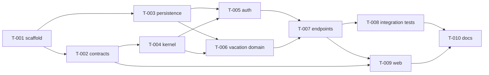

# SPEC-001 — Execution plan

## 1. Meta

| Field | Value |
|---|---|
| Parent epic | [SPEC-001: LeaveFlow — Vacation Request Management](./epic.md) |
| Tasks source | [tasks.md](./tasks.md) |
| Status | `in-progress` |
| Created | 2026-10-14 |
| Last updated | 2026-10-14 |

### Execution preferences

| Field | Value |
|---|---|
| Engine | `task-tool` — executed **in-session by the orchestrator, sequentially** (no sub-agents: the owner did not request them and the tasks share one tightly-coupled codebase; recorded here so the deviation from parallel task agents is explicit) |
| Stop mode | `auto` — owner said "start development"; pause only on failure or a user-required gate |
| Concurrency cap | 1 (follows from in-session execution) |
| Review enabled | `false` — automated review gates in §8 instead |
| Compliance critical | `false` |

---

## 2. Summary

Ten tasks in six waves. Backend foundations first (contracts, persistence, kernel), then business logic, then HTTP surface, then proof (integration tests) and UI, then documentation. Each task ends with a conventional commit.

---

## 3. Dependency graph

---

## 4. Critical path

T-001 → T-002 → T-004 → T-006 → T-007 → T-009 → T-010.

---

## 5. Dry-run preview

### 5.1 Path overlaps (merge risk)

Sequential execution — no concurrent writers. Shared hot spots: `apps/api/src/bootstrap/container.ts` and `root.yaml` (touched by T-004…T-007, sequentially).

### 5.2 External dependencies

- **Packages:** commoneventframework@1.0.19 (exact), typeorm@0.3, pg, zod@3, pino@9, jsonwebtoken, bcryptjs, tsx, vitest@3, vue@3.5, vue-router@4, pinia@3, axios, vite@7, tailwindcss@4, concurrently.
- **Env vars:** `DATABASE_URL`, `TEST_DATABASE_URL`, `JWT_SECRET`, `JWT_ISSUER`, `JWT_AUDIENCE`, `JWT_TTL_SECONDS`, `BUSINESS_TIMEZONE`, `LOG_LEVEL`, `NODE_ENV`, `API_PORT`.
- **Services:** Docker (PostgreSQL 16 on host port 5544).

### 5.3 Language / toolchain mix

| Language | Tasks |
|---|---|
| TS (Node) | T-001…T-008 |
| TS (Vue) | T-009 |
| SQL (migration) | T-003 |
| Markdown | T-010 |

---

## 6. Execution waves

- **Wave 1:** T-001
- **Wave 2:** T-002, T-003
- **Wave 3:** T-004
- **Wave 4:** T-005, T-006
- **Wave 5:** T-007
- **Wave 6:** T-008, T-009
- **Wave 7:** T-010

---

## 8. Review gates

| Gate | When | How triggered | Notes |
|---|---|---|---|
| Code review (automated) | epic end | `/code-review` skill on the branch | available in this environment; run locally (no PR needed for the local diff form) |
| Security review (automated) | after T-005/T-007 (auth surface) | `/security-review` skill | requires `origin/HEAD` — available once the GitHub remote exists; otherwise `aspirational — not wired as of 2026-10-14` |
| DB change review | T-003 | `aspirational — not wired as of 2026-10-14` (no DB-review skill installed) | down-migration verified in T-003 regardless; no destructive DDL |
| Code review (thorough, user-run) | epic end | **user runs `/code-review ultra`** | reminded at hand-off |
| Architecture review | epic end | orchestrator compares epic §11–§13 with implementation | listed deviations go to hand-off |
| User functional verification | epic end | user walks epic §18.4 | aggregated at hand-off |

---

## 9. Risk register (execution-level)

| Risk | Likelihood | Impact | Mitigation |
|---|---|---|---|
| CEF dev-server quirks surface late | medium | high | T-004 live-exercises `--local` before any business code |
| TypeORM + esbuild decorator metadata | medium | high | explicit column types from T-003; integration tests run through tsx (esbuild) |
| Scope creep vs 2–3h brief | medium | medium | MAY items (FR-34) only after all MUSTs green |

---

## 11. Progress log

| Task | Wave | Agent | Started | Completed | Status | Notes |
|---|---|---|---|---|---|---|
| T-001 | 1 | orchestrator | 2026-10-14 | 2026-10-14 | completed | compose healthy, both DBs, btree_gist; audit highs removed via overrides |
| T-002 | 2 | orchestrator | 2026-10-14 | 2026-10-14 | completed | 27 tests |
| T-003 | 2 | orchestrator | 2026-10-14 | 2026-10-14 | completed | migrations up/down/up; every constraint proven by direct SQL |
| T-004 | 3 | orchestrator | 2026-10-14 | 2026-10-14 | completed | live CEF dev server: error boundary keeps serving; found cef-gen-handlers no-op bug |
| T-005 | 4 | orchestrator | 2026-10-14 | 2026-10-14 | completed | |
| T-006 | 4 | orchestrator | 2026-10-14 | 2026-10-14 | completed | seed via CommandBus |
| T-007 | 5 | orchestrator | 2026-10-14 | 2026-10-14 | completed | live smoke of every endpoint |
| T-008 | 6 | orchestrator | 2026-10-14 | 2026-10-14 | completed | 148 tests; exposed deadlock + event-order defects, fixed (epic v0.3) |
| T-009 | 6 | orchestrator | 2026-10-14 | — | in-progress | |
| T-010 | 7 | orchestrator | — | — | not-started | |
