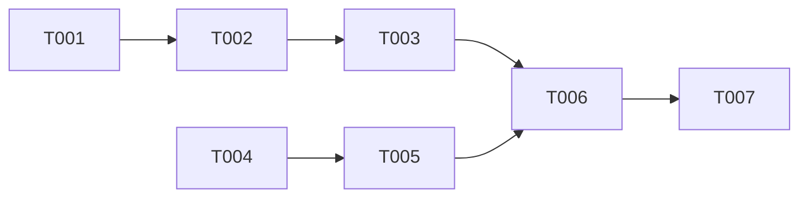

# SPEC-003 — Execution plan

## 1. Meta

| Field | Value |
|---|---|
| Parent epic | [SPEC-003](./epic.md) |
| Tasks source | [tasks.md](./tasks.md) |
| Status | `completed` |
| Created | 2026-10-14 |

| Execution preference | Value |
|---|---|
| Engine | `task-tool` — executed in-session by the orchestrator, sequentially (tightly coupled moves) |
| Stop mode | `auto` (owner: "execute") |
| Concurrency cap | 1 |
| Review enabled | `false` |

## 3. Dependency graph

## 6. Waves

1. T-001 → T-002 → T-003 (backend, sequential: shared paths)
2. T-004 → T-005 (frontend)
3. T-006 → T-007 (docs, after code settles so cited paths are final)

## 8. Review gates

| Gate | When | How |
|---|---|---|
| Behaviour preservation | after each structural task | `npm run verify`; integration ×3 after T-003 |
| UI walkthrough | after T-005 | browser, both roles |
| Docs truthfulness | after T-006/T-007 | path-existence script |

## 11. Progress log

| Task | Started | Completed | Status | Notes |
|---|---|---|---|---|
| T-001 | 2026-10-14 | 2026-10-14 | completed | moves via scripted git mv + import rewrite; verify green |
| T-002 | 2026-10-14 | 2026-10-14 | completed | verify green |
| T-003 | 2026-10-14 | 2026-10-14 | completed | command/handler split; integration ×3 green |
| T-004 | 2026-10-14 | 2026-10-14 | completed | feature folders, per-feature api + routes |
| T-005 | 2026-10-14 | 2026-10-14 | completed | 4 stores, 11 store tests, browser walkthrough both roles |
| T-006 | 2026-10-14 | 2026-10-14 | completed | 8 specs + index; all cited paths verified |
| T-007 | 2026-10-14 | 2026-10-14 | completed | compliance matrix; README/CLAUDE.md; paths verified |
